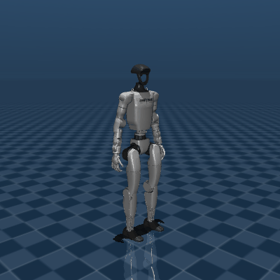

# Gymnastics Facility Robot

[日本語](README.ja.md) | **English** | [中文](README.md)

© 2026 MotionLink. All rights reserved.

<!-- Project badges: repository metrics update through Shields.io; technology labels describe this codebase. -->
[](https://github.com/Tsubasaas/Gymnastics-Facility-Robot_vf/commits/main/)
[](https://github.com/Tsubasaas/Gymnastics-Facility-Robot_vf/stargazers)
[](https://github.com/Tsubasaas/Gymnastics-Facility-Robot_vf/issues)
[](https://github.com/Tsubasaas/Gymnastics-Facility-Robot_vf/forks)

[](requirements-real.txt)
[](开始彩排.bat)
[](real_robot.py)
[](sim_viewer.py)

**Let Unitree G1 demonstrate radio calisthenics and guide participants with Japanese speech and camera-based feedback.**

This project connects motion choreography, MuJoCo previews, Qwen motion generation, speech synthesis, visual feedback, and G1 upper-body control. You do not need a robot to get started: preview the motions on your computer first, then add a camera and physical robot in stages.

Changing the README language changes the documentation only. The current demonstration dialogue remains Japanese.

## 1. What can it do?

| Feature | What you see or hear | Requirements |
| --- | --- | --- |
| Offline motion preview | A G1 model plays presets with pause, replay, motion selection, and speed controls | Computer, MuJoCo, G1 model |
| Calisthenics demonstration | A wave and hand-to-chest greeting, followed by stretching, arm swings, arm circles, chest opening, and side bends | `demo_viewer.py`; no API key |
| Japanese voice coaching | Opening greeting, instructions for each section, and closing remarks; console captions when speech is not configured | `demo_voice.py`; cloud API for speech |
| Camera interaction | Identifies participants by A/B/C chest labels or agreed positions, gives short Japanese feedback, and records session results | Camera, vision-model API, demonstration clock |
| Natural-language choreography | Text such as “slowly raise your right hand, then lower it” becomes joint waypoints for preview or validation | `ai_viewer.py` / `ai_robot.py`, motion-generation API |
| Physical G1 coaching | Executes upper-body and explicitly enabled waist motions after operator confirmation; optional G1 speaker output | SDK-capable G1 EDU, network, on-site commissioning |

**The current demonstration adapts five sections of Radio Taiso No. 1; it is not a full-body reproduction of all thirteen sections.** Motions are adapted to G1 joint and speed limits. This project does not control walking or reproduce the leg exercises. Other basic motions and longer sequences exist in the repository; their preset numbers differ from the demonstration entry point.

The MuJoCo viewer uses **kinematic playback**, directly setting joint angles. It helps inspect appearance, timing, joint limits, and model self-collisions, but does not establish physical balance, load handling, or contact safety. Visual feedback is qualitative, based on sampled images and rules, rather than precise human joint measurement.

### Preview assets

This existing basic-motion preview is not a recording of the complete current five-section demonstration:



More animations: [preview](preview/). Video: [group gymnastics.mp4](group%20gymnastics.mp4).

## 2. Technology stack and workflow

| Layer | Implementation | Files |
| --- | --- | --- |
| Runtime | Python; examples target Windows PowerShell; physical-robot environment uses Python 3.10 | `requirements-real.txt` |
| Motion data | Joint-angle waypoints, linear interpolation, beat-based choreography, execution speed limiting | `motions.py`, `demo_viewer.py`, `real_robot.py` |
| 3D preview | MuJoCo and the Unitree G1 model from Google DeepMind MuJoCo Menagerie | `sim_viewer.py`, `ai_viewer.py` |
| Motion generation | OpenAI Python SDK with the DashScope international compatible endpoint; default `qwen3-max` | `llm_motion.py` |
| Visual feedback | OpenCV / NumPy sampling, DashScope SDK; default `qwen3-vl-plus`, preview localization via `qwen3-vl-flash` | `vision_coach.py`, `vision_rules.py` |
| Speech | Default `qwen3-tts-flash`, `Cherry` voice, Japanese; asynchronous queue and audio cache | `tts_qwen.py`, `demo_voice.py` |
| Robot communication | Unitree SDK2 Python and CycloneDDS 0.10.2; reads `rt/lowstate`, publishes `rt/arm_sdk` | `real_robot.py` |
| Camera transport | Local OpenCV, or Paramiko SSH to start PC2 capture followed by JPEG over TCP; separate DDS RPC entry for the head camera | `robot_camera.py`, `brio_sender.py` |
| Robot audio | Unitree `AudioClient.PlayStream`, 16 kHz / 16-bit / mono PCM | `robot_speaker.py` |
| Process coordination | JSON files for the playback clock, observations, and session report | `vision_clock.json`, `observations.json`, `session_report.json` |

Motion: **Preset or text → waypoints → joint and timeline validation → preview / robot speed limiting → operator confirmation → G1 execution.**

Interaction: **Demonstration clock → camera keyframes → vision model and feedback rules → observations → speech.** Current rules cover arm circles, chest opening, and side bends; see `SECTIONS` in `vision_rules.py`.

Model names are code defaults; availability depends on your DashScope international account permissions. Cloud features transmit text or sampled camera images and may incur API charges. Obtain participants’ consent before recording them.

## 3. First run: preview on your computer

### 3.1 Get the project and create a preview environment

Install Git and Python 3.10. If the repository is private, authenticate Git with a GitHub account that has access.

Run these commands in PowerShell. Run all subsequent scripts from the project root.

```powershell
git clone https://github.com/Tsubasaas/Gymnastics-Facility-Robot_vf.git
cd Gymnastics-Facility-Robot_vf
py -3.10 -m venv .venv
.\.venv\Scripts\python.exe -m pip install --upgrade pip
.\.venv\Scripts\python.exe -m pip install mujoco "openai>=2.0,<3" "dashscope>=1.20,<2" opencv-python numpy paramiko
```

The preview environment `.venv` is separate from the robot environment `.venv-real`. Both directories are excluded by `.gitignore`.

### 3.2 Download the G1 model

```powershell
git clone --depth 1 https://github.com/google-deepmind/mujoco_menagerie.git
Test-Path .\mujoco_menagerie\unitree_g1\scene.xml
```

The last command should return `True`. This relative path is the code default. If you store the model elsewhere, change `MODEL_PATH` in `sim_viewer.py`. For a ZIP download, preserve the meshes and other resources referenced by the model XML; copying only `scene.xml` is insufficient.

### 3.3 Play the five-section demonstration

```powershell
$env:PYTHONUTF8 = '1'
$env:DEMO_PAUSED = '1'
.\.venv\Scripts\python.exe demo_viewer.py
```

**Success:** a 3D G1 window appears. Click the window and press Space to start. The default full sequence includes the greeting and five exercise sections.

| Key | Demonstration viewer action |
| --- | --- |
| `1` | Full demonstration |
| `2`–`6` | Individual exercise sections |
| `7` | Greeting |
| Space | Pause / resume |
| `R` / `L` | Replay from the start / toggle looping |
| `←` / `→` | Back / forward 5 seconds |
| `-` / `=` | Decrease / increase playback speed |
| `Esc` | Exit the viewer |

For the basic motion collection, run `.\.venv\Scripts\python.exe sim_viewer.py`. Its numbering differs; follow the terminal output. Once dependencies and models are installed, both previews work without internet access or an API key.

## 4. Add Japanese speech, AI, and visual interaction

### 4.1 Configure the API key

The project uses DashScope **international** endpoints. Set the environment variable in the PowerShell window used to launch the program; do not put keys in source files.

```powershell
$apiCredential = Get-Credential -UserName 'DashScope' -Message 'Enter your DashScope international API key in the password field'
$env:DASHSCOPE_API_KEY = $apiCredential.GetNetworkCredential().Password
```

Child processes inherit the variable. Set it again in independently opened terminals. The program does not automatically load `.env` files.

### 4.2 Start the narrated demonstration or natural-language preview

```powershell
# Five sections with Japanese speech; captions remain available without speech setup
.\.venv\Scripts\python.exe demo_voice.py

# Natural-language motion preview; close the previous program first
.\.venv\Scripts\python.exe ai_viewer.py
```

Enter natural-language instructions in the terminal for `ai_viewer.py`. Start with slow, small, single-arm motions and inspect generated results before considering physical execution.

### 4.3 Use a laptop camera

Open two PowerShell windows, enter the same project root, and configure the API key in both.

Window A:

```powershell
$env:VISION_NAMES = 'AB'
.\.venv\Scripts\python.exe vision_coach.py --cam 0 --show
```

Window B:

```powershell
$env:VISION_NAMES = 'AB'
$env:DEMO_PAUSED = '1'
.\.venv\Scripts\python.exe demo_voice.py
```

Participants should wear clearly visible A/B labels and take their agreed positions. “等待时钟” (waiting for the clock) in window A is expected initially. Press Space in the simulation window to start the full demonstration; the vision process then samples and evaluates in sync. Feedback reaches the voice process through `observations.json`; session output is stored in `session_report.json` and `records/`.

Feedback is not guaranteed for every section if no person is recognized, results arrive late, or speech is busy. Change `--cam 0` to the correct camera index if needed.

### 4.4 Use the external Brio camera attached to G1

After completing the robot environment and network setup below, set the device password in the same window that launches the camera:

```powershell
$deviceCredential = Get-Credential -UserName 'unitree' -Message 'Enter the PC2 SSH password'
$env:PC2_PASS = $deviceCredential.GetNetworkCredential().Password
.\.venv-real\Scripts\python.exe robot_camera.py --probe
```

Defaults are PC2 `192.168.123.164` and user `unitree`. If your setup differs, edit `PC2_HOST` / `PC2_USER` in `robot_camera.py`. PC2 needs Python 3, OpenCV, SSH, and camera access permissions. See `brio_sender.py`; this entry point uploads and starts the capture script and restarts an existing capture process with the same name.

After a successful frame capture, run `.\.venv-real\Scripts\python.exe vision_coach.py --show`. A missing `PC2_PASS` causes an error before SSH login. The head camera can be tested separately with `robot_camera.py --source head --probe`; the vision coach’s default remains the external Brio.

## 5. Start the physical G1 workflow

### 5.1 Power-on and on-site preparation

This project targets **SDK-capable G1 EDU robots**. Confirm the actual 23 / 29 DOF configuration and waist hardware. The full demonstration uses waist pitch and roll; “29 DOF” alone does not establish compatibility with the hardware and current control mode.

1. A trained operator must fit fall protection and check the battery, cables, clearance, and emergency-stop arrangements. One person must hold the physical emergency stop or remote throughout operation.
2. Follow the official manual for that particular G1 to power on, complete startup checks, and establish the required posture. Power-button sequences, remote combinations, and control modes depend on hardware and firmware; this repository does not automate them.
3. Verify that the current mode supports this project’s `arm_sdk` upper-body interface and stop conflicting upper-body controllers. Do not copy a whole-body low-level example’s startup procedure or arbitrarily stop services needed for standing.
4. Complete the read-only check, then the small-motion probe, before individual sections and the full demonstration.

Consult the [official Unitree G1 developer documentation](https://support.unitree.com/home/zh/G1_developer) for hardware operations and the [official Unitree SDK2 Python repository](https://github.com/unitreerobotics/unitree_sdk2_python) for SDK setup. This guide covers this project’s software startup; it does not replace the hardware-specific power-on and mode instructions.

### 5.2 Create a separate robot environment

```powershell
py -3.10 -m venv .venv-real
.\.venv-real\Scripts\python.exe -m pip install --upgrade pip
.\.venv-real\Scripts\python.exe -m pip install -r requirements-real.txt
.\.venv-real\Scripts\python.exe -m pip install opencv-python numpy paramiko
```

`requirements-real.txt` pins CycloneDDS and a Unitree SDK commit and includes OpenAI / DashScope SDKs. The last command adds camera dependencies. Physical execution itself does not need the MuJoCo model; computer rehearsals continue to use `.venv`.

If CycloneDDS cannot be found, follow the [official SDK installation instructions](https://github.com/unitreerobotics/unitree_sdk2_python#installation) to configure the native library and `CYCLONEDDS_HOME`. Do not arbitrarily change pinned versions to work around an installation error. Windows native dependencies may require additional setup.

### 5.3 Configure the wired network

These are the existing site addresses; confirm they match your setup:

| Device | Example configuration |
| --- | --- |
| G1 PC2 | `192.168.123.164` |
| Computer’s wired adapter connected to the robot | `192.168.123.222`, mask `255.255.255.0` |

Place the computer adapter on the same subnet without an address conflict. `--interface` takes the **computer adapter’s IP**, not the robot’s IP.

```powershell
ping 192.168.123.164
```

Ping checks IP connectivity only. Receiving `lowstate` in the next step verifies the DDS link. For timeouts, check the selected adapter, firewall rules, and DDS networking.

### 5.4 First connection: read state only

This example assumes a confirmed 29 DOF robot. Adjust the argument for a 23 DOF robot.

```powershell
.\.venv-real\Scripts\python.exe ai_robot.py `
  --robot-dof 29 --interface 192.168.123.222 --read-only
```

**Success:** the program reports fresh G1 `lowstate`, prints joint angles, modes, and temperatures, and confirms that no `rt/arm_sdk` publisher was created. This step needs no API key and sends no motion commands.

### 5.5 First motion: a 5° right-elbow probe

Configure `DASHSCOPE_API_KEY` in the current terminal as described in 4.1. **The current code initializes the AI client before the interactive loop, so even `probe` and preset inputs require a key and the OpenAI SDK.** Presets and the probe do not themselves request model-generated motion. Read-only mode is unaffected.

```powershell
.\.venv-real\Scripts\python.exe ai_robot.py `
  --robot-dof 29 --interface 192.168.123.222 `
  --max-speed-deg 10 --execute
```

Follow the terminal prompts:

1. Verify site conditions and enter `ENABLE REAL ROBOT`.
2. After state reception and the `AI-G1 >` prompt, enter `probe`.
3. Check that the plan moves the right elbow 5° relative to its current angle and returns.
4. Enter the complete current `RUN XXXX` code shown by the program. Any other input cancels the motion.
5. Verify direction, return motion, and control-weight release, then enter `q` to exit.

During motion, `Ctrl+C` triggers software interruption and control-weight release. **It is not a substitute for a physical emergency stop.** In a hazardous situation, the operator must use the established hardware emergency-stop procedure.

### 5.6 Progress from individual sections to the full demonstration

Start the demonstration entry point at low speed:

```powershell
.\.venv-real\Scripts\python.exe demo_robot.py `
  --robot-dof 29 --interface 192.168.123.222 `
  --max-speed-deg 10 --execute
```

After startup confirmation, test `p1` first and check each section separately. Every motion requires its own `RUN XXXX` confirmation.

| `demo_robot.py` input | Motion |
| --- | --- |
| `p1` | Stretching |
| `p2` | Arm swings |
| `p3` | Arm circles |
| `p4` | Chest opening, including waist pitch |
| `p5` | Side bends, including waist roll |
| `p6` | Wave and hand-to-chest greeting, including waist motion |
| `p7` | Greeting and all five sections |

Motions using disabled waist joints are rejected by design. Add `--allow-waist-roll-pitch` only after confirming hardware and mode compatibility and testing the individual sections. Once the operator has verified a suitable performance speed, the full demonstration command is:

```powershell
.\.venv-real\Scripts\python.exe demo_robot.py `
  --robot-dof 29 --interface 192.168.123.222 `
  --max-speed-deg 45 --allow-waist-roll-pitch --robot-speaker --execute
```

Enter `p7` and the current confirmation code. `45°/s` is the demonstration entry point’s default and the maximum allowed by the code, not a recommended first-test speed. Lower limits extend motion duration; verify speech and vision timing on site. If G1 audio is unavailable, playback attempts to fall back to the computer.

For visual interaction, start the vision process from 4.3 or 4.4 beforehand. The robot demonstration writes the same clock files. On completion, wait for control-weight release, enter `q`, close the vision process, and let the operator restore posture and power down according to the hardware manual.

### 5.7 Existing batch launchers

- `开始彩排.bat`: vision uses `.venv-real`, while the narrated preview uses the current `python`. Prepare both environments, run `.\.venv\Scripts\Activate.ps1`, then launch the batch file from the terminal containing your environment variables so child processes inherit the key and password.
- `真机演出.bat`: currently hardcodes 29 DOF and `192.168.123.222`, enables waist motion and the robot speaker, and uses the default `45°/s`. **Use the step-by-step commands above for initial commissioning, not this batch launcher.**

## 6. Configuration and file guide

| Environment variable | Purpose / default |
| --- | --- |
| `DASHSCOPE_API_KEY` | Cloud motion, vision, and speech API key |
| `PC2_PASS` | SSH password for the robot’s external-camera connection; no default |
| `QWEN_MODEL` | Motion model: `qwen3-max` |
| `VISION_MODEL` / `VISION_PREVIEW_MODEL` | Exercise assessment / preview localization models |
| `QWEN_TTS_MODEL` / `QWEN_TTS_VOICE` / `QWEN_TTS_LANGUAGE` | Speech model / voice / language |
| `VISION_NAMES` | Participant letters, default `ABC`; use `AB` for two people |
| `DEMO_PAUSED` | `1` starts simulation paused |
| `DEMO_BPM` / `DEMO_GAP` | Choreography tempo / section gap; defaults `77` / `1.0` seconds |
| `DEMO_COUNT` | `1` enables optional beat counting |
| `G1_SPEAKER_VOLUME` / `G1_SPEAKER_GAIN` | Robot audio volume / software gain |

Do not increase tempo or motion amplitude merely to remove speed-limit messages. Recheck motions and physical timing after changes.

| What to inspect or edit | Files |
| --- | --- |
| Five sections, timing, greeting | [demo_viewer.py](demo_viewer.py) |
| Basic motions and waypoint export | [motions.py](motions.py), [export_waypoints.py](export_waypoints.py) |
| Japanese dialogue and speech timing | [demo_voice.py](demo_voice.py) |
| Visual assessment and feedback rules | [vision_rules.py](vision_rules.py) |
| Robot speed limits, state monitoring, weight release | [real_robot.py](real_robot.py) |
| Additional robot notes (Chinese) | [REAL_ROBOT.md](REAL_ROBOT.md) |
| Basic-motion / demonstration checks | [validate.py](validate.py), [_check_demo.py](_check_demo.py) |

```powershell
# Run in the preview environment with MuJoCo and the downloaded model
.\.venv\Scripts\python.exe validate.py
.\.venv\Scripts\python.exe _check_demo.py
```

These checks do not drive the robot and do not replace on-site testing.

## 7. Troubleshooting

| Problem | What to check |
| --- | --- |
| `scene.xml` not found | Start from the project root; check model directory layout and `MODEL_PATH` |
| `py -3.10` unavailable | Install Python 3.10 or use its full executable path to create the environment |
| Captions but no speech | Check the process’s key, DashScope dependency, international endpoint, and model permissions; local playback targets Windows |
| Presets ask for an API key | The robot interactive entry initializes `MotionAgent`; configure 4.1 or use the offline viewer first |
| Vision keeps waiting for the clock | Run `demo_voice.py` or `demo_robot.py` from the same directory and start the full demonstration |
| External-camera login fails | Check `PC2_PASS`, address, user, SSH access, and PC2 OpenCV / camera permissions |
| No `lowstate` | Check the computer adapter IP, DDS, firewall, and robot services; do not skip read-only verification |
| Waist motion rejected | Verify hardware and on-site authorization before enabling waist joints; do not remove validation |
| Slower playback or mistimed speech | Speed limiting stretches the timeline; check speed, tempo, API latency, and execution state |
| No robot audio | Check G1 audio service and volume; inspect terminal messages for computer fallback |

This guide reflects the current repository. Installation, cloud permissions, and robot firmware affect results; verify each stage’s success criteria during first deployment.
