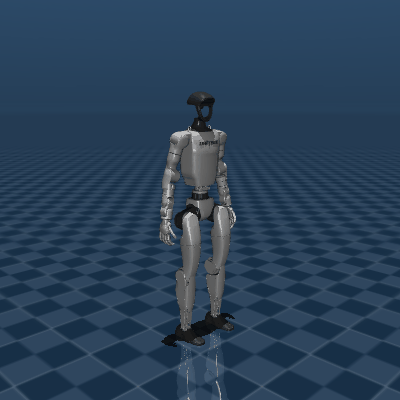
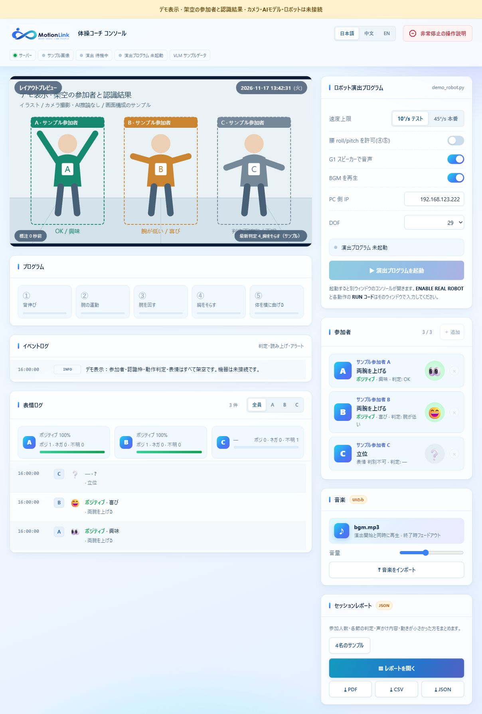
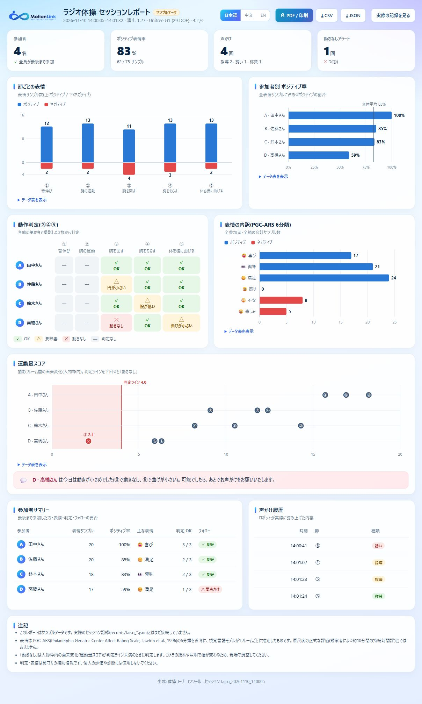

# Gymnastics Facility Robot

**日本語** | [English](README.en.md) | [中文](README.md)

© 2026 MotionLink. All rights reserved.

<!-- Project badges: repository metrics update through Shields.io; technology labels describe this codebase. -->
[](https://github.com/Tsubasaas/Gymnastics-Facility-Robot_vf/commits/main/)
[](https://github.com/Tsubasaas/Gymnastics-Facility-Robot_vf/stargazers)
[](https://github.com/Tsubasaas/Gymnastics-Facility-Robot_vf/issues)
[](https://github.com/Tsubasaas/Gymnastics-Facility-Robot_vf/forks)

[](requirements-real.txt)
[](开始彩排.bat)
[](real_robot.py)
[](sim_viewer.py)

**Unitree G1 がラジオ体操を実演し、日本語の音声とカメラによるフィードバックで参加者の運動をサポートします。**

動作の振り付け、MuJoCo でのプレビュー、Qwen による動作生成、音声合成、画像認識、G1 の上半身制御を組み合わせたプロジェクトです。最初から実機を用意する必要はありません。まず PC 上で動作を確認し、その後カメラと実機を段階的に接続します。

README の言語切り替えはドキュメントのみが対象です。現在のデモの音声台詞は日本語のままです。

## 1. プロジェクトの背景：なぜ開発するのか？

**本プロジェクトは、介護施設の介護職員の負担軽減を目指す、人型ロボットによる体操支援プロジェクトです。** 繰り返しの体操指導や記録整理をロボットが補助することで、職員が高齢者一人ひとりのニーズ、現場のケア、人との交流により多くの時間を使えるようにしたいと考えています。

介護施設での集団体操では、職員が動作の実演、声かけ、参加状況の観察、終了後の記録整理を同時に担います。複数の高齢者が参加すると、体操を進行しながら全員の様子を継続的に見ることは難しく、終了後にも断片的な観察を振り返れる記録にまとめる必要があります。

G1 による繰り返し可能な動作実演と日本語音声、カメラによる動作・表情のサンプリング、根拠を追跡できるセッションレポートを組み合わせ、この流れを支援する方法を探っています。介護施設の集団体操・ケア活動に実演・観察・記録の道具を提供することが目的であり、実際の負担軽減効果は現場での利用評価が必要です。

開発では次の3点を重視しています。

- **動作をどのように準備するか？** PC で動作を確認し、実機では低速から段階的に検証します。
- **フィードバックの根拠をどう残すか？** 参加者の文字ラベル、撮影画像、動作判定、声かけを同じセッションに紐付け、不確実な結果も保持します。
- **記録をどう振り返りやすくするか？** 観察と音声処理の過程を Web レポートとエクスポート可能なデータに整理し、職員が確認できるようにします。

ロボットの役割は補助です。活動の運営、現場の安全、ケアの判断は職員が担います。現状は動作する技術試作であり、健康状態の改善を実証したものでも、専門的評価の代わりになるものでもありません。

## 2. 何ができる？

**体操の実演 → 動作・表情の観察 → 活動レポートの出力。**

**MuJoCo × Unitree SDK2 × Qwen3-VL × Python** に **Qwen TTS の日本語音声**を組み合わせ、**PGC-ARS の表情分類**を参考に観察記録を整理します。

| プロセス | 技術・処理の仕組み | 実装済みの機能と役割 |
| --- | --- | --- |
| **01 体操の実演と音声による進行** | **シミュレーション確認 → 実機実行**：MuJoCo で動作を確認し、Unitree SDK2 で G1 を動かし、Qwen TTS で日本語音声を出力します。 | 動作の実演に開始の挨拶、各節の案内、終了の声かけを組み合わせ、職員による体操進行を補助します。手振りと胸前の挨拶に続き、背伸び、腕振り、腕回し、胸をそらす運動、体側屈の5種目を行います。 |
| **02 動作と表情の観察** | **OpenCV × Qwen3-VL**：カメラ画像を取得し、読める胸の文字で参加者を識別。動作ルールと画素変化のスコアで観察し、表情分類は PGC-ARS を参考にします。 | コンソールで画像、動作判定、表情サンプルを確認し、一部の動作の問題や動きの小ささに短い日本語の声かけを行います。不確実な結果を保持し、立ち位置から本人を推測しません。 |
| **03 活動レポートの出力** | **JSON × Python**：セッション記録を保存・集計し、動作判定、撮影画像、表情イベント、Qwen TTS の音声処理記録を紐付けて Web レポートを生成します。 | 参加者・種目ごとに観察、表情の分布、音声処理状態と根拠画像を確認できます。PDF 印刷、CSV / JSON 出力により記録整理と情報共有を支援します。 |

### 今後の拡張（未実装）

- **ウェアラブル連携**：対応機器の生理データと活動記録を併せて表示し、職員による変化の把握を支援する構想です。血圧・体温等のデータには現在接続していません。
- **医療・介護データベース連携**：許可を得た上で活動記録と既存のケア情報を関連付け、専門職が確認できるようにする構想です。関連インターフェースは未実装です。

動作・表情の観察はバイタル測定ではなく、健康状態の判定や疾病の早期発見を可能にするものではありません。コードは PGC-ARS の6分類を参考にモデル出力を整理していますが、原尺度の正式な評価ではありません。音声処理記録も参加者に音が聞こえたことを保証しません。活動レポート全体の自動音声解説は未実装です。

初回は API キー不要の `demo_viewer.py` によるオフライン確認から始められます。音声・視覚連携にはクラウド API、実機運転には SDK 対応 G1 EDU と現場調整が必要です。自然言語による動作生成は `ai_viewer.py` / `ai_robot.py` を参照してください。

**現在のデモはラジオ体操第一の5種目をアレンジしたもので、全13種目を全身で再現するものではありません。** G1 の関節や速度制限に合わせて動きを調整しています。歩行制御や脚の体操動作は実装していません。リポジトリには別の基本動作や長いシーケンスもありますが、デモ用のプリセット番号とは異なります。

MuJoCo ビューアーは関節角度を直接設定する**運動学的な再生**です。見た目、タイミング、関節可動域、モデル内の自己衝突を確認できますが、実機のバランス、負荷、接触時の安全性を保証するものではありません。画像からのフィードバックは、抽出したフレームとルールに基づく定性的な助言であり、人体の関節角度を精密に測定するものではありません。

### プレビュー素材

以下は既存の基本動作プレビューです。現在の5種目デモ全体の録画ではありません。



その他のアニメーションは [preview](preview/)、動画は [group gymnastics.mp4](group%20gymnastics.mp4) を参照してください。


#### 視覚認識コンソール（デモ表示）

既存のコンソールに、架空の参加者、イラストによる認識枠、動作判定、表情ログを表示しています。**サンプルデータであり、実際のカメラ映像やAIの認識結果ではありません。** カメラ・クラウドモデル・ロボットには接続せず、ロボット起動ボタンは無効です。



#### 活動レポート（4名のサンプル）

内蔵の4名サンプルで、表情の集計、動作判定、運動量、参加者サマリー、声かけ履歴を示します。**参加者と数値はすべて架空です。** 参加完了表示は実際の記録で全時間の参加を確認できることを意味せず、サンプルの判定も現場検証の結果ではありません。声かけ内容は日本語の原文です。



再現するには `python preview_console_demo.py` を実行し、コンソールは `http://127.0.0.1:8082/?lang=ja`、レポートは `http://127.0.0.1:8082/report?mode=sample&lang=ja` を開いてください。実際の記録は通常のコンソールまたは `preview_console.py` で確認できます。


## 3. 技術スタックと処理の流れ

| レイヤー | 実装 | 主なファイル |
| --- | --- | --- |
| 実行環境 | Python。操作例は Windows PowerShell 向け。実機環境は Python 3.10 | `requirements-real.txt` |
| 動作データ | 関節角度の経由点、線形補間、拍に合わせた振り付け、実行前の速度制限 | `motions.py`、`demo_viewer.py`、`real_robot.py` |
| 3D プレビュー | MuJoCo と Google DeepMind MuJoCo Menagerie の Unitree G1 モデル | `sim_viewer.py`、`ai_viewer.py` |
| 動作生成 | OpenAI Python SDK から DashScope 国際版の互換 API を使用。既定は `qwen3-max` | `llm_motion.py` |
| 画像フィードバック | OpenCV / NumPy で画像を取得し、DashScope SDK で推論。既定は `qwen3-vl-plus`、プレビューの位置検出は `qwen3.7-flash` | `vision_coach.py`、`vision_rules.py` |
| 音声 | 既定は `qwen3-tts-flash`、音声 `Cherry`、日本語。非同期キューと音声キャッシュを使用 | `tts_qwen.py`、`demo_voice.py` |
| 実機通信 | Unitree SDK2 Python と CycloneDDS 0.10.2。`rt/lowstate` を受信し、`rt/arm_sdk` に送信 | `real_robot.py` |
| カメラ通信 | ローカル OpenCV、または Paramiko SSH で PC2 の取得処理を起動し TCP で JPEG を転送。頭部カメラ用 DDS RPC 入口もあり | `robot_camera.py`、`brio_sender.py` |
| ロボット音声 | Unitree `AudioClient.PlayStream`、16 kHz / 16 bit / モノラル PCM | `robot_speaker.py` |
| プロセス間連携 | JSON ファイルで再生時計、観察結果、セッションレポートを共有 | `vision_clock.json`、`observations.json`、`session_report.json` |

動作の流れ：**プリセットまたは文章 → 経由点 → 関節と時間軸の検証 → プレビュー / 実機の速度制限 → 操作者の確認 → G1 が実行。**

対話の流れ：**デモの再生時計 → カメラのキーフレーム → 画像認識モデルと助言ルール → 観察結果 → 音声。** 現在の判定ルールは腕回し、胸を反らす運動、体側屈の3種目です。`vision_rules.py` の `SECTIONS` が基準になります。

モデル名はコード上の既定値です。利用可否は DashScope 国際版アカウントの権限に依存します。クラウド機能では文章やカメラから抽出した画像が送信され、API 料金が発生する場合があります。撮影前に参加者の同意を得てください。

## 4. 実行方法：PC 操作とロボット操作

PC のオフライン確認 → 音声・カメラのリハーサル → ロボットの電源投入とリモコン準備 → PC 接続と読み取り専用チェック → 低速テスト → 各種目と通しデモ、の順に進めます。初回体験は 4.1 だけでよく、ロボットは不要です。

| 段階 | 操作場所 | 対応する手順 |
| --- | --- | --- |
| オフライン確認 | PC | 4.1：取得、環境、モデル、再生 |
| 対話リハーサル | PC とカメラ | 4.2：API、音声、カメラ |
| 実機準備 | ロボットとリモコン | 4.3.1：転倒防止、電源投入、モード切り替え |
| 実機運転 | ロボットに接続した PC | 4.3.2～4.3.6：環境、ネットワーク、読み取り、テスト、実演 |
| 終了・収納 | PC、ロボット、リモコン | 4.3.1 の終了手順：プログラム終了、支持、ダンピング、電源切断 |
| レポートと問題確認 | PC | 4.4：コンソール・レポート・設定、4.5：問題対処 |

### 4.1 PC 操作：オフライン動作プレビュー

#### 4.1.1 プロジェクトの取得とプレビュー環境の作成

Git と Python 3.10 を準備します。リポジトリが非公開の場合は、アクセス権のある GitHub アカウントで Git の認証を済ませてください。

以下は PowerShell 用です。以降のスクリプトはすべてプロジェクトのルートディレクトリから起動します。

```powershell
git clone https://github.com/Tsubasaas/Gymnastics-Facility-Robot_vf.git
cd Gymnastics-Facility-Robot_vf
py -3.10 -m venv .venv
.\.venv\Scripts\python.exe -m pip install --upgrade pip
.\.venv\Scripts\python.exe -m pip install mujoco "openai>=2.0,<3" "dashscope>=1.20,<2" opencv-python numpy paramiko
```

PC プレビュー用の `.venv` と実機用の `.venv-real` を分けます。両ディレクトリは `.gitignore` に登録済みで、Git にアップロードされません。

#### 4.1.2 G1 モデルのダウンロード

```powershell
git clone --depth 1 https://github.com/google-deepmind/mujoco_menagerie.git
Test-Path .\mujoco_menagerie\unitree_g1\scene.xml
```

最後のコマンドが `True` を返せば配置できています。コードは既定でこの相対パスを参照します。別の場所に置く場合は `sim_viewer.py` の `MODEL_PATH` を変更してください。ZIP で取得する場合も XML が参照するメッシュ等のリソースを残し、`scene.xml` だけをコピーしないでください。

#### 4.1.3 5種目デモの再生

```powershell
$env:PYTHONUTF8 = '1'
$env:DEMO_PAUSED = '1'
.\.venv\Scripts\python.exe demo_viewer.py
```

**成功の目安：** G1 の3D ウィンドウが表示されます。ウィンドウをクリックし、スペースキーで再生します。既定の通し再生には挨拶と5種目が含まれます。

| キー | デモ用ビューアーの操作 |
| --- | --- |
| `1` | 通し再生 |
| `2`～`6` | 各種目 |
| `7` | 挨拶動作 |
| スペース | 一時停止 / 再開 |
| `R` / `L` | 最初から再生 / ループ切り替え |
| `←` / `→` | 5秒戻る / 進む |
| `-` / `=` | 再生速度を下げる / 上げる |
| `Esc` | ビューアーを終了 |

基本動作集は `.\.venv\Scripts\python.exe sim_viewer.py` で確認できます。デモ用ビューアーとは番号が異なるため、端末の表示に従ってください。依存パッケージとモデルの取得後は、どちらもインターネット接続や API キーなしで利用できます。

### 4.2 PC 操作：音声・AI・カメラのリハーサル

#### 4.2.1 API キーの設定

本プロジェクトは DashScope **国際版**のエンドポイントを使用します。起動に使う PowerShell ウィンドウで環境変数を設定し、キーをソースコードに書き込まないでください。

```powershell
$apiCredential = Get-Credential -UserName 'DashScope' -Message 'パスワード欄に DashScope 国際版の API キーを入力'
$env:DASHSCOPE_API_KEY = $apiCredential.GetNetworkCredential().Password
```

このウィンドウから起動する子プロセスには引き継がれます。独立して開いた端末では再設定が必要です。プログラムは `.env` ファイルを自動で読み込みません。

#### 4.2.2 音声付きデモ、または自然言語プレビューの起動

```powershell
# 5種目のデモと日本語音声。音声未設定時も字幕でリハーサル可能
.\.venv\Scripts\python.exe demo_voice.py

# 自然言語による動作プレビュー。上のプログラムを終了してから実行
.\.venv\Scripts\python.exe ai_viewer.py
```

`ai_viewer.py` の文章指示は端末に入力します。最初は片腕の小さな動きを低速で試し、生成結果を確認してから実機利用を検討してください。

#### 4.2.3 ノート PC のカメラを使用

PowerShell を2つ開き、両方で同じプロジェクトルートに移動して API キーを設定します。

ウィンドウ A：

```powershell
$env:VISION_NAMES = 'AB'
.\.venv\Scripts\python.exe vision_coach.py --cam 0 --show
```

ウィンドウ B：

```powershell
$env:VISION_NAMES = 'AB'
$env:DEMO_PAUSED = '1'
.\.venv\Scripts\python.exe demo_voice.py
```

参加者は目立つ A/B の文字を胸に付け、事前に決めた位置に立ちます。A 側の初期表示「等待时钟」（再生時計の待機中）は正常です。シミュレーション画面でスペースキーを押して通し再生を始めると、画像処理が動作に合わせて取得・判定を開始します。助言は `observations.json` から音声プロセスへ渡り、セッション出力は `session_report.json` と `records/` に保存されます。

人物を認識できない場合、結果が遅れた場合、音声出力が使用中の場合などは、毎種目のフィードバックを保証しません。カメラ番号が違う場合は `--cam 0` を実際の番号に変えてください。

#### 4.2.4 G1 に接続した外付け Brio カメラを使用

後述の実機環境とネットワーク設定を終えてから、カメラを起動する同じウィンドウで機器のパスワードを設定します。

```powershell
$deviceCredential = Get-Credential -UserName 'unitree' -Message 'PC2 の SSH パスワードを入力'
$env:PC2_PASS = $deviceCredential.GetNetworkCredential().Password
.\.venv-real\Scripts\python.exe robot_camera.py --probe
```

既定の PC2 アドレスは `192.168.123.164`、ユーザーは `unitree` です。異なる場合は `robot_camera.py` の `PC2_HOST` / `PC2_USER` を変更します。PC2 には Python 3、OpenCV、SSH サービス、カメラへのアクセス権が必要です。取得スクリプトは `brio_sender.py` を参照してください。この入口はスクリプトを転送して起動し、同名の取得プロセスがあれば再起動します。

フレーム取得に成功したら `.\.venv-real\Scripts\python.exe vision_coach.py --show` で接続します。`PC2_PASS` が未設定なら SSH ログイン前にエラーになります。頭部内蔵カメラは `robot_camera.py --source head --probe` で個別に確認できますが、画像コーチの既定入力は外付け Brio です。

### 4.3 実機操作：ロボット準備と PC からの接続確認

#### 4.3.1 電源投入と現場の準備

対象は **SDK 対応の G1 EDU** です。実機の 23 / 29 DOF と腰のハードウェア構成を必ず確認してください。通しデモは腰の pitch / roll を使用するため、「29 DOF」というだけで現在のハードウェアや制御モードが対応しているとは判断できません。

1. 機器に習熟した操作者が転倒防止設備を装着し、バッテリー、配線、可動範囲、緊急停止手段を確認します。運転中は1名が物理的な緊急停止装置またはリモコンを持ちます。
2. その G1 に対応する公式マニュアルに従って、電源投入、起動時点検、必要な姿勢の準備を行います。電源ボタンやリモコンの操作、制御モードはハードウェアとファームウェアによって異なり、本リポジトリでは自動化していません。
3. 現在のモードが本プロジェクトの `arm_sdk` 上半身インターフェースに対応していることを確認し、競合する上半身制御プログラムを停止します。全身低レベル制御のサンプル手順を流用したり、立位維持に必要なサービスを不用意に停止したりしないでください。
4. 以下の読み取り専用チェック、小幅のテストを順に完了してから、各種目と通しデモへ進みます。

機器の操作は [Unitree G1 公式開発ドキュメント](https://support.unitree.com/home/zh/G1_developer)、SDK 設定は [Unitree SDK2 Python 公式リポジトリ](https://github.com/unitreerobotics/unitree_sdk2_python) を参照してください。本書はプロジェクトのソフトウェア起動手順であり、実機ごとの電源投入・モード操作マニュアルを代替するものではありません。

##### 実機プログラム起動前の電源・リモコン操作

現場メモと [Unitree 公式の運動制御説明](https://github.com/unitreerobotics/xr_teleoperate/wiki/Motion) に基づきます。実機のファームウェアが以下のキー割り当てに対応することを確認し、旧版と混用しないでください。各状態への移行を確認してから次へ進みます。

| 順序 | 操作 | 確認事項 |
| --- | --- | --- |
| 1. 電源投入 | 電源スイッチを**1回短押ししてから長押し** | 先に転倒防止を整え、長押し時間と表示をバッテリーマニュアルで確認し、起動時点検を待ちます。 |
| 2. ダンピング | **L2 + B** | Damping は立位を保持しません。切り替え前に適切な架台・吊り具で確実に支持します。 |
| 3. 立位固定 | **L2 + ↑**（方向キー上） | 本機の手順に従って支持・接地姿勢を準備し、正常な Locked Standing を確認します。 |
| 4. 通常運動制御 | **R1 + X** | 公式説明では腰1自由度の通常モードです。安定し異常がないことを確認してから上半身プログラムを準備します。 |
| 5. ソフトウェア確認 | 4.3.2～4.3.4 と `--read-only` | 新鮮な `lowstate` の受信後、4.3.5 の低速右肘テストを行い、成功後に各種目・通しデモへ進みます。 |

**`R1 + X` は腰の pitch / roll を許可する操作ではありません。** ハードウェア・ファームウェア・制御モードを別途確認し、4.3.6 に従って検証してください。単に `--allow-waist-roll-pitch` を追加しないでください。本プロジェクトは `arm_sdk` を使用するため、全身低レベル制御用デバッグモードの起動手順を流用しません。

##### 実演終了と電源切断

1. 正常終了後、`arm_sdk` の制御ウェイト解放を待ち、`q` で終了し、画像・音声プロセスを閉じます。
2. 本機のマニュアルに従い、安全にダンピングへ移行できる支持・姿勢を整えます。**支持されていない立位から直接ダンピングへ切り替えないでください。**
3. **L2 + B** で Damping に移行し、支持設備が重量を支えていることを確認します。
4. 本機のマニュアルに従って終了姿勢とバッテリー電源切断を完了し、電源が切れたことを確認して収納します。**`L2 + B` はダンピングであり、シャットダウン・電源切断ではありません。** 電源切断の操作はバッテリーマニュアルに従い、起動手順から推測しません。

#### 4.3.2 実機用の独立環境を作成

```powershell
py -3.10 -m venv .venv-real
.\.venv-real\Scripts\python.exe -m pip install --upgrade pip
.\.venv-real\Scripts\python.exe -m pip install -r requirements-real.txt
.\.venv-real\Scripts\python.exe -m pip install opencv-python numpy paramiko
```

`requirements-real.txt` は CycloneDDS のバージョンと Unitree SDK のコミットを固定し、OpenAI / DashScope SDK も指定しています。最後のコマンドでカメラ関連の依存パッケージを追加します。実機動作そのものには MuJoCo モデルは不要です。PC 上のリハーサルには引き続き `.venv` を使用します。

CycloneDDS が見つからない場合は、[公式 SDK のインストール手順](https://github.com/unitreerobotics/unitree_sdk2_python#installation)に従い、ネイティブの CycloneDDS と `CYCLONEDDS_HOME` を設定してください。インストールエラーを回避するためだけに固定バージョンを変更しないでください。Windows ではネイティブ依存関係の追加設定が必要な場合があります。

#### 4.3.3 有線ネットワークの設定

以下は現在の現場設定例です。使用前に実際の環境と一致するか確認してください。

| 機器 | 設定例 |
| --- | --- |
| G1 PC2 | `192.168.123.164` |
| ロボットにつなぐ PC の有線 NIC | `192.168.123.222`、サブネットマスク `255.255.255.0` |

PC の該当 NIC を同じサブネットに設定し、アドレスの重複を避けます。`--interface` に指定するのはロボットではなく、**PC 側の NIC の IP アドレス**です。

```powershell
ping 192.168.123.164
```

Ping で確認できるのは IP 接続のみです。DDS の確認は次の `lowstate` 受信で行います。タイムアウト時は NIC の選択、ファイアウォールのルール、DDS のネットワーク設定を確認してください。

#### 4.3.4 初回接続：状態の読み取りのみ

以下は確認済みの 29 DOF 機を想定しています。23 DOF 機では引数を変更してください。

```powershell
.\.venv-real\Scripts\python.exe ai_robot.py `
  --robot-dof 29 --interface 192.168.123.222 --read-only
```

**成功の目安：** 新しい G1 `lowstate` を受信した旨と、関節角度、モード、温度が表示され、最後に `rt/arm_sdk` publisher を作成していないと表示されます。この手順は API キー不要で、動作指令を送信しません。

#### 4.3.5 最初の動作：右肘を 5° 動かすテスト

4.2.1 の手順で現在の端末に `DASHSCOPE_API_KEY` を設定します。**現行コードは対話ループに入る時点で AI クライアントを初期化するため、`probe` やプリセットだけを使う場合もキーと OpenAI SDK が必要です。** プリセットやテスト自体は動作生成モデルにリクエストしません。読み取り専用モードはこの制約を受けません。

```powershell
.\.venv-real\Scripts\python.exe ai_robot.py `
  --robot-dof 29 --interface 192.168.123.222 `
  --max-speed-deg 10 --execute
```

端末の案内に従って操作します。

1. 現場の条件を確認し、`ENABLE REAL ROBOT` を入力します。
2. 状態を受信し `AI-G1 >` が表示されたら `probe` を入力します。
3. 計画を読み、現在の角度から右肘を 5° 動かして元に戻す内容であることを確認します。
4. その場で表示された `RUN XXXX` を省略せず入力します。他の入力なら動作はキャンセルされます。
5. 動く方向、元の姿勢への復帰、制御ウェイトの解放を確認し、`q` で終了します。

動作中の `Ctrl+C` はソフトウェアの中断と制御ウェイトの解放を開始しますが、**物理的な緊急停止の代わりにはなりません。** 危険時は現場の操作者が確認済みのハードウェア緊急停止手順を使用してください。

#### 4.3.6 各種目から通しデモへ進む

まずデモ用入口を低速で起動します。

```powershell
.\.venv-real\Scripts\python.exe demo_robot.py `
  --robot-dof 29 --interface 192.168.123.222 `
  --max-speed-deg 10 --execute
```

起動確認後は `p1` から始め、種目ごとに確認します。動作ごとに別の `RUN XXXX` 確認が必要です。

| `demo_robot.py` への入力 | 動作 |
| --- | --- |
| `p1` | 背伸び |
| `p2` | 腕振り |
| `p3` | 腕回し |
| `p4` | 胸を反らす運動。腰の pitch を含む |
| `p5` | 体側屈。腰の roll を含む |
| `p6` | 手振りと胸に手を添える挨拶。腰の動作を含む |
| `p7` | 挨拶 + 5種目の通し |

腰を有効にしていない場合、該当関節を使う動作は意図的に拒否されます。腰のハードウェア、制御モード、各種目の動作確認を済ませた場合に限り、`--allow-waist-roll-pitch` を追加してください。現場で適切な演出速度を確認した後は、以下を使用できます。

```powershell
.\.venv-real\Scripts\python.exe demo_robot.py `
  --robot-dof 29 --interface 192.168.123.222 `
  --max-speed-deg 45 --allow-waist-roll-pitch --robot-speaker --execute
```

`p7` とその都度表示される確認コードを入力すると通しデモが始まります。`45°/s` はデモ用入口の既定値かつコードが許可する最大値であり、初回テストの推奨速度ではありません。低速設定では動作時間が延びるため、音声と画像処理のタイミングも現場で確認してください。G1 の音声サービスが使えない場合は PC での再生に切り替えを試みます。

画像フィードバックを使う場合は 4.2.3 または 4.2.4 のプロセスを先に起動してください。実機デモも同じ再生時計ファイルを書き込みます。終了後は制御ウェイトの解放を待ち、`q` で終了し、画像処理を閉じてから、操作者が実機マニュアルに従って姿勢復帰と電源切断を行います。

#### 4.3.7 既存のバッチ起動ファイルについて

- `开始彩排.bat`：画像処理は `.venv-real`、音声付きプレビューは現在の `python` を使用します。両環境を準備し、`.\.venv\Scripts\Activate.ps1` を実行してからバッチを起動します。キーやパスワードを設定した端末から起動し、子プロセスに環境変数を引き継いでください。
- `真机演出.bat`：29 DOF と `192.168.123.222` が固定され、腰とロボットスピーカーが有効、速度は既定の `45°/s` です。**初回の接続・動作確認ではこのバッチを直接起動せず、上記の段階的なコマンドを使用してください。**

### 4.4 コンソール・レポート・設定

#### コンソール・実際の記録・4名のサンプル

PC カメラでは `python vision_coach.py --web --cam 0` を実行します。ロボットの外付けカメラでは `--cam 0` を省略します。同じセッション ID の仕組みを使うため、実演・音声プロセスも同時に再起動してください。更新前に実演を終了し、画像・実演・音声プロセスを閉じ、更新後は同じプロジェクトディレクトリから起動します。旧プロセスを混在させないでください。「非常停止の操作説明」はヘルプを開くだけで停止命令を送りません。現場では物理的な非常停止・リモコンを使います。

`/report` は最も最近更新された実際の記録を読み、`/report?mode=sample` は4名のサンプルを表示します。`/report?id=taiso_<sessionID>.json` でセッションを指定できます。実際の記録がなくても自動的にサンプルへ置き換わりません。

新しい判定記録にはセッション ID、認識 ID、モデルの元出力、撮影時刻、人物枠、運動量スコアを保存します。レポートで対応する画像を展開できます。記録と画像はローカルの `records/` に保存され、Git には含めません。本人の識別は明瞭な胸の文字だけを使い、位置から推測しません。重複文字や不確実な結果を自動的に達成扱いにしません。現在のコードは③腕回し・④胸をそらす運動・⑤体側屈を判定対象に設定し、有効フレームが3枚未満ならサンプル不足として記録します。

表情は撮影時点のセッション・種目・参加者・時刻・画像とともに保存し、待機中のプレビューは活動統計に含めません。不明な表情は別に数え、ポジティブ率の分母から除外します。動作判定を優先し、表情は通常4秒間隔で取得します。Web・デバッグ画面がなくても取得し、追加の API リクエストが発生します。

音声ごとに独立した ID があり、フィードバックには元の認識 ID とフィードバック ID も紐付きます。処理記録は待ち行列、合成、再生処理、失敗、代替再生、ミュートによるスキップ、旧セッションの取り消し、字幕のみの状態を残します。同じ文章の繰り返しも別の音声です。PC の `completed` はブロッキング再生が正常終了したことを示します。G1 の `robot_sent` は PlayStream の受け付けと想定時間の待機を示すだけで、**ハードウェアによる再生完了確認でも、現場で聞こえた証拠でもありません**。実際の完了確認にはハードウェア側の対応が必要です。全時間の参加完了も推測せず、旧記録の欠損値を補造しません。

表情・音声は `records/events/<sessionID>/` に原子的なイベントファイルとして保存し、複数プロセスの上書きを避けます。実際のレポートは表情明細と音声状態の時系列に統合し、CSV/JSON に関連 ID を含めます。認識枠は認識時の同じ画像と時刻に表示し、実演中のライブ映像には古い枠を重ねません。

カメラ・実機を使わない画面確認は `python preview_console.py` を実行して `http://[::1]:8081/` を開きます。ローカルの実際の記録と4名サンプルも読めますが、実機は起動しません。対応関係のオフラインテスト：`python -m unittest -v test_observation_records test_session_events`（カメラ・モデル・再生装置は模擬）。

| 環境変数 | 用途 / 既定値 |
| --- | --- |
| `DASHSCOPE_API_KEY` | クラウドの動作生成・画像認識・音声 API キー |
| `PC2_PASS` | 外付けロボットカメラ接続用の SSH パスワード。既定値なし |
| `QWEN_MODEL` | 動作生成モデル：`qwen3-max` |
| `VISION_MODEL` / `VISION_PREVIEW_MODEL` | 動作判定 / プレビュー位置検出モデル |
| `QWEN_TTS_MODEL` / `QWEN_TTS_VOICE` / `QWEN_TTS_LANGUAGE` | 音声モデル / 声 / 言語 |
| `VISION_NAMES` | 参加者の文字。既定は `ABC`、2人なら `AB` |
| `DEMO_PAUSED` | `1` でシミュレーションを一時停止状態で起動 |
| `DEMO_BPM` / `DEMO_GAP` | 振り付けのテンポ / 種目間の間隔。既定は `77` / `1.0` 秒 |
| `DEMO_COUNT` | `1` で拍の読み上げを有効化 |
| `G1_SPEAKER_VOLUME` / `G1_SPEAKER_GAIN` | G1 の音量 / ソフトウェアゲイン |

速度制限の表示を消すためだけにテンポや動作幅を増やさないでください。変更後は動作と実機のタイミングを再確認します。

| 確認・変更したい内容 | ファイル |
| --- | --- |
| 5種目の動作、テンポ、挨拶 | [demo_viewer.py](demo_viewer.py) |
| 基本動作と経由点の書き出し | [motions.py](motions.py)、[export_waypoints.py](export_waypoints.py) |
| 日本語台詞と発話タイミング | [demo_voice.py](demo_voice.py) |
| 画像判定の基準と助言 | [vision_rules.py](vision_rules.py) |
| 実機の速度制限、状態監視、制御ウェイト解放 | [real_robot.py](real_robot.py) |
| 実機の補足説明（中国語） | [REAL_ROBOT.md](REAL_ROBOT.md) |
| 基本動作 / デモ動作のチェック | [validate.py](validate.py)、[_check_demo.py](_check_demo.py) |

```powershell
# MuJoCo とモデルを用意したプレビュー環境で実行
.\.venv\Scripts\python.exe validate.py
.\.venv\Scripts\python.exe _check_demo.py
```

これらのチェックでは実機を動かしません。現場でのテストを代替するものではありません。

### 4.5 よくある問題

| 問題 | 確認すること |
| --- | --- |
| `scene.xml` が見つからない | プロジェクトルートから起動し、モデルの階層と `MODEL_PATH` を確認 |
| `py -3.10` が使えない | Python 3.10 をインストールするか、その `python.exe` のフルパスで環境を作成 |
| 字幕だけで音声が出ない | 現在のプロセスのキー、DashScope 依存関係、国際版エンドポイント、モデル権限を確認。PC 音声再生は Windows 向け |
| プリセットでも API キーを要求される | 実機の対話入口が `MotionAgent` を初期化するため。4.2.1 を設定するか、先にオフラインビューアーを使用 |
| 画像処理が再生時計を待ち続ける | 同じディレクトリで `demo_voice.py` または `demo_robot.py` を実行し、通し再生を開始 |
| 外付けカメラにログインできない | `PC2_PASS`、アドレス、ユーザー、SSH、PC2 の OpenCV とカメラ権限を確認 |
| `lowstate` が来ない | PC の NIC IP、DDS、ファイアウォール、実機サービスを確認。読み取り専用チェックを省略しない |
| 腰の動作が拒否される | ハードウェアと現場の許可を確認してから腰の引数を追加。検証処理を削除しない |
| デモが遅い、音声がずれる | 速度制限で時間軸が延びる。速度、テンポ、API 遅延、実行状態を確認 |
| G1 スピーカーから音が出ない | G1 の音声サービスと音量、PC 再生への切り替えメッセージを確認 |

本書は現在のリポジトリのコードに基づいています。環境構築、クラウドの権限、実機のファームウェアによって結果は変わるため、初回導入では各段階の成功の目安を順に確認してください。
