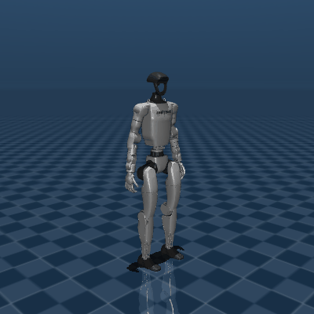

# Gymnastics Facility Robot

**日本語** | [English](README.en.md) | [中文](README.md)

<!-- Project badges: repository metrics update through Shields.io; technology labels describe this codebase. -->
[](https://github.com/Tsubasaas/Gymnastics-Facility-Robot_vf/commits/main/)
[](https://github.com/Tsubasaas/Gymnastics-Facility-Robot_vf/stargazers)
[](https://github.com/Tsubasaas/Gymnastics-Facility-Robot_vf/issues)
[](https://github.com/Tsubasaas/Gymnastics-Facility-Robot_vf/forks)

[](requirements-real.txt)
[](开始彩排.bat)
[](real_robot.py)
[](sim_viewer.py)

**Unitree G1 がラジオ体操を実演し、日本語の音声とカメラによるフィードバックで参加者の運動をサポートします。**

動作の振り付け、MuJoCo でのプレビュー、Qwen による動作生成、音声合成、画像認識、G1 の上半身制御を組み合わせたプロジェクトです。最初から実機を用意する必要はありません。まず PC 上で動作を確認し、その後カメラと実機を段階的に接続します。

README の言語切り替えはドキュメントのみが対象です。現在のデモの音声台詞は日本語のままです。

## 1. 何ができる？

| 機能 | 確認できる動作・出力 | 必要なもの |
| --- | --- | --- |
| オフライン動作プレビュー | G1 モデルがプリセットを再生。一時停止、リプレイ、動作切り替え、速度変更が可能 | PC、MuJoCo、G1 モデル |
| ラジオ体操デモ | 手振りと胸に手を添える挨拶の後、背伸び、腕振り、腕回し、胸を反らす運動、体側屈の5種目 | `demo_viewer.py`。API キー不要 |
| 日本語の音声ガイド | 開始の挨拶、種目ごとの説明、終了の挨拶。音声未設定時はコンソールに字幕を表示 | `demo_voice.py`。音声にはクラウド API が必要 |
| カメラによる対話 | 胸の A/B/C の文字や事前に決めた立ち位置で参加者を区別し、短い日本語の助言とセッション記録を生成 | カメラ、画像認識モデル API、デモの再生時計 |
| 自然言語による動作作成 | 「右手をゆっくり上げてから下ろす」などの文章を関節の経由点に変換して確認 | `ai_viewer.py` / `ai_robot.py`、動作生成 API |
| G1 実機での実演 | 操作者の確認後、上半身と明示的に許可した腰の動作を実行。G1 スピーカーでの音声出力も可能 | SDK 対応の G1 EDU、ネットワーク、現場での動作確認 |

**現在のデモはラジオ体操第一の5種目をアレンジしたもので、全13種目を全身で再現するものではありません。** G1 の関節や速度制限に合わせて動きを調整しています。歩行制御や脚の体操動作は実装していません。リポジトリには別の基本動作や長いシーケンスもありますが、デモ用のプリセット番号とは異なります。

MuJoCo ビューアーは関節角度を直接設定する**運動学的な再生**です。見た目、タイミング、関節可動域、モデル内の自己衝突を確認できますが、実機のバランス、負荷、接触時の安全性を保証するものではありません。画像からのフィードバックは、抽出したフレームとルールに基づく定性的な助言であり、人体の関節角度を精密に測定するものではありません。

### プレビュー素材

以下は既存の基本動作プレビューです。現在の5種目デモ全体の録画ではありません。



その他のアニメーションは [preview](preview/)、動画は [group gymnastics.mp4](group%20gymnastics.mp4) を参照してください。

## 2. 技術スタックと処理の流れ

| レイヤー | 実装 | 主なファイル |
| --- | --- | --- |
| 実行環境 | Python。操作例は Windows PowerShell 向け。実機環境は Python 3.10 | `requirements-real.txt` |
| 動作データ | 関節角度の経由点、線形補間、拍に合わせた振り付け、実行前の速度制限 | `motions.py`、`demo_viewer.py`、`real_robot.py` |
| 3D プレビュー | MuJoCo と Google DeepMind MuJoCo Menagerie の Unitree G1 モデル | `sim_viewer.py`、`ai_viewer.py` |
| 動作生成 | OpenAI Python SDK から DashScope 国際版の互換 API を使用。既定は `qwen3-max` | `llm_motion.py` |
| 画像フィードバック | OpenCV / NumPy で画像を取得し、DashScope SDK で推論。既定は `qwen3-vl-plus`、プレビューの位置検出は `qwen3-vl-flash` | `vision_coach.py`、`vision_rules.py` |
| 音声 | 既定は `qwen3-tts-flash`、音声 `Cherry`、日本語。非同期キューと音声キャッシュを使用 | `tts_qwen.py`、`demo_voice.py` |
| 実機通信 | Unitree SDK2 Python と CycloneDDS 0.10.2。`rt/lowstate` を受信し、`rt/arm_sdk` に送信 | `real_robot.py` |
| カメラ通信 | ローカル OpenCV、または Paramiko SSH で PC2 の取得処理を起動し TCP で JPEG を転送。頭部カメラ用 DDS RPC 入口もあり | `robot_camera.py`、`brio_sender.py` |
| ロボット音声 | Unitree `AudioClient.PlayStream`、16 kHz / 16 bit / モノラル PCM | `robot_speaker.py` |
| プロセス間連携 | JSON ファイルで再生時計、観察結果、セッションレポートを共有 | `vision_clock.json`、`observations.json`、`session_report.json` |

動作の流れ：**プリセットまたは文章 → 経由点 → 関節と時間軸の検証 → プレビュー / 実機の速度制限 → 操作者の確認 → G1 が実行。**

対話の流れ：**デモの再生時計 → カメラのキーフレーム → 画像認識モデルと助言ルール → 観察結果 → 音声。** 現在の判定ルールは腕回し、胸を反らす運動、体側屈の3種目です。`vision_rules.py` の `SECTIONS` が基準になります。

モデル名はコード上の既定値です。利用可否は DashScope 国際版アカウントの権限に依存します。クラウド機能では文章やカメラから抽出した画像が送信され、API 料金が発生する場合があります。撮影前に参加者の同意を得てください。

## 3. 初回起動：まず PC で動作を確認

### 3.1 プロジェクトの取得とプレビュー環境の作成

Git と Python 3.10 を準備します。リポジトリが非公開の場合は、アクセス権のある GitHub アカウントで Git の認証を済ませてください。

以下は PowerShell 用です。以降のスクリプトはすべてプロジェクトのルートディレクトリから起動します。

```powershell
git clone https://github.com/Tsubasaas/Gymnastics-Facility-Robot_vf.git
cd Gymnastics-Facility-Robot_vf
py -3.10 -m venv .venv
.\.venv\Scripts\python.exe -m pip install --upgrade pip
.\.venv\Scripts\python.exe -m pip install mujoco "openai>=2.0,<3" "dashscope>=1.20,<2" opencv-python numpy paramiko
```

PC プレビュー用の `.venv` と実機用の `.venv-real` を分けます。両ディレクトリは `.gitignore` に登録済みで、Git にアップロードされません。

### 3.2 G1 モデルのダウンロード

```powershell
git clone --depth 1 https://github.com/google-deepmind/mujoco_menagerie.git
Test-Path .\mujoco_menagerie\unitree_g1\scene.xml
```

最後のコマンドが `True` を返せば配置できています。コードは既定でこの相対パスを参照します。別の場所に置く場合は `sim_viewer.py` の `MODEL_PATH` を変更してください。ZIP で取得する場合も XML が参照するメッシュ等のリソースを残し、`scene.xml` だけをコピーしないでください。

### 3.3 5種目デモの再生

```powershell
$env:PYTHONUTF8 = '1'
$env:DEMO_PAUSED = '1'
.\.venv\Scripts\python.exe demo_viewer.py
```

**成功の目安：** G1 の3D ウィンドウが表示されます。ウィンドウをクリックし、スペースキーで再生します。既定の通し再生には挨拶と5種目が含まれます。

| キー | デモ用ビューアーの操作 |
| --- | --- |
| `1` | 通し再生 |
| `2`～`6` | 各種目 |
| `7` | 挨拶動作 |
| スペース | 一時停止 / 再開 |
| `R` / `L` | 最初から再生 / ループ切り替え |
| `←` / `→` | 5秒戻る / 進む |
| `-` / `=` | 再生速度を下げる / 上げる |
| `Esc` | ビューアーを終了 |

基本動作集は `.\.venv\Scripts\python.exe sim_viewer.py` で確認できます。デモ用ビューアーとは番号が異なるため、端末の表示に従ってください。依存パッケージとモデルの取得後は、どちらもインターネット接続や API キーなしで利用できます。

## 4. 日本語音声・AI・カメラ連携を追加

### 4.1 API キーの設定

本プロジェクトは DashScope **国際版**のエンドポイントを使用します。起動に使う PowerShell ウィンドウで環境変数を設定し、キーをソースコードに書き込まないでください。

```powershell
$apiCredential = Get-Credential -UserName 'DashScope' -Message 'パスワード欄に DashScope 国際版の API キーを入力'
$env:DASHSCOPE_API_KEY = $apiCredential.GetNetworkCredential().Password
```

このウィンドウから起動する子プロセスには引き継がれます。独立して開いた端末では再設定が必要です。プログラムは `.env` ファイルを自動で読み込みません。

### 4.2 音声付きデモ、または自然言語プレビューの起動

```powershell
# 5種目のデモと日本語音声。音声未設定時も字幕でリハーサル可能
.\.venv\Scripts\python.exe demo_voice.py

# 自然言語による動作プレビュー。上のプログラムを終了してから実行
.\.venv\Scripts\python.exe ai_viewer.py
```

`ai_viewer.py` の文章指示は端末に入力します。最初は片腕の小さな動きを低速で試し、生成結果を確認してから実機利用を検討してください。

### 4.3 ノート PC のカメラを使用

PowerShell を2つ開き、両方で同じプロジェクトルートに移動して API キーを設定します。

ウィンドウ A：

```powershell
$env:VISION_NAMES = 'AB'
.\.venv\Scripts\python.exe vision_coach.py --cam 0 --show
```

ウィンドウ B：

```powershell
$env:VISION_NAMES = 'AB'
$env:DEMO_PAUSED = '1'
.\.venv\Scripts\python.exe demo_voice.py
```

参加者は目立つ A/B の文字を胸に付け、事前に決めた位置に立ちます。A 側の初期表示「等待时钟」（再生時計の待機中）は正常です。シミュレーション画面でスペースキーを押して通し再生を始めると、画像処理が動作に合わせて取得・判定を開始します。助言は `observations.json` から音声プロセスへ渡り、セッション出力は `session_report.json` と `records/` に保存されます。

人物を認識できない場合、結果が遅れた場合、音声出力が使用中の場合などは、毎種目のフィードバックを保証しません。カメラ番号が違う場合は `--cam 0` を実際の番号に変えてください。

### 4.4 G1 に接続した外付け Brio カメラを使用

後述の実機環境とネットワーク設定を終えてから、カメラを起動する同じウィンドウで機器のパスワードを設定します。

```powershell
$deviceCredential = Get-Credential -UserName 'unitree' -Message 'PC2 の SSH パスワードを入力'
$env:PC2_PASS = $deviceCredential.GetNetworkCredential().Password
.\.venv-real\Scripts\python.exe robot_camera.py --probe
```

既定の PC2 アドレスは `192.168.123.164`、ユーザーは `unitree` です。異なる場合は `robot_camera.py` の `PC2_HOST` / `PC2_USER` を変更します。PC2 には Python 3、OpenCV、SSH サービス、カメラへのアクセス権が必要です。取得スクリプトは `brio_sender.py` を参照してください。この入口はスクリプトを転送して起動し、同名の取得プロセスがあれば再起動します。

フレーム取得に成功したら `.\.venv-real\Scripts\python.exe vision_coach.py --show` で接続します。`PC2_PASS` が未設定なら SSH ログイン前にエラーになります。頭部内蔵カメラは `robot_camera.py --source head --probe` で個別に確認できますが、画像コーチの既定入力は外付け Brio です。

## 5. G1 実機を起動して動かす

### 5.1 電源投入と現場の準備

対象は **SDK 対応の G1 EDU** です。実機の 23 / 29 DOF と腰のハードウェア構成を必ず確認してください。通しデモは腰の pitch / roll を使用するため、「29 DOF」というだけで現在のハードウェアや制御モードが対応しているとは判断できません。

1. 機器に習熟した操作者が転倒防止設備を装着し、バッテリー、配線、可動範囲、緊急停止手段を確認します。運転中は1名が物理的な緊急停止装置またはリモコンを持ちます。
2. その G1 に対応する公式マニュアルに従って、電源投入、起動時点検、必要な姿勢の準備を行います。電源ボタンやリモコンの操作、制御モードはハードウェアとファームウェアによって異なり、本リポジトリでは自動化していません。
3. 現在のモードが本プロジェクトの `arm_sdk` 上半身インターフェースに対応していることを確認し、競合する上半身制御プログラムを停止します。全身低レベル制御のサンプル手順を流用したり、立位維持に必要なサービスを不用意に停止したりしないでください。
4. 以下の読み取り専用チェック、小幅のテストを順に完了してから、各種目と通しデモへ進みます。

機器の操作は [Unitree G1 公式開発ドキュメント](https://support.unitree.com/home/zh/G1_developer)、SDK 設定は [Unitree SDK2 Python 公式リポジトリ](https://github.com/unitreerobotics/unitree_sdk2_python) を参照してください。本書はプロジェクトのソフトウェア起動手順であり、実機ごとの電源投入・モード操作マニュアルを代替するものではありません。

### 5.2 実機用の独立環境を作成

```powershell
py -3.10 -m venv .venv-real
.\.venv-real\Scripts\python.exe -m pip install --upgrade pip
.\.venv-real\Scripts\python.exe -m pip install -r requirements-real.txt
.\.venv-real\Scripts\python.exe -m pip install opencv-python numpy paramiko
```

`requirements-real.txt` は CycloneDDS のバージョンと Unitree SDK のコミットを固定し、OpenAI / DashScope SDK も指定しています。最後のコマンドでカメラ関連の依存パッケージを追加します。実機動作そのものには MuJoCo モデルは不要です。PC 上のリハーサルには引き続き `.venv` を使用します。

CycloneDDS が見つからない場合は、[公式 SDK のインストール手順](https://github.com/unitreerobotics/unitree_sdk2_python#installation)に従い、ネイティブの CycloneDDS と `CYCLONEDDS_HOME` を設定してください。インストールエラーを回避するためだけに固定バージョンを変更しないでください。Windows ではネイティブ依存関係の追加設定が必要な場合があります。

### 5.3 有線ネットワークの設定

以下は現在の現場設定例です。使用前に実際の環境と一致するか確認してください。

| 機器 | 設定例 |
| --- | --- |
| G1 PC2 | `192.168.123.164` |
| ロボットにつなぐ PC の有線 NIC | `192.168.123.222`、サブネットマスク `255.255.255.0` |

PC の該当 NIC を同じサブネットに設定し、アドレスの重複を避けます。`--interface` に指定するのはロボットではなく、**PC 側の NIC の IP アドレス**です。

```powershell
ping 192.168.123.164
```

Ping で確認できるのは IP 接続のみです。DDS の確認は次の `lowstate` 受信で行います。タイムアウト時は NIC の選択、ファイアウォールのルール、DDS のネットワーク設定を確認してください。

### 5.4 初回接続：状態の読み取りのみ

以下は確認済みの 29 DOF 機を想定しています。23 DOF 機では引数を変更してください。

```powershell
.\.venv-real\Scripts\python.exe ai_robot.py `
  --robot-dof 29 --interface 192.168.123.222 --read-only
```

**成功の目安：** 新しい G1 `lowstate` を受信した旨と、関節角度、モード、温度が表示され、最後に `rt/arm_sdk` publisher を作成していないと表示されます。この手順は API キー不要で、動作指令を送信しません。

### 5.5 最初の動作：右肘を 5° 動かすテスト

4.1 の手順で現在の端末に `DASHSCOPE_API_KEY` を設定します。**現行コードは対話ループに入る時点で AI クライアントを初期化するため、`probe` やプリセットだけを使う場合もキーと OpenAI SDK が必要です。** プリセットやテスト自体は動作生成モデルにリクエストしません。読み取り専用モードはこの制約を受けません。

```powershell
.\.venv-real\Scripts\python.exe ai_robot.py `
  --robot-dof 29 --interface 192.168.123.222 `
  --max-speed-deg 10 --execute
```

端末の案内に従って操作します。

1. 現場の条件を確認し、`ENABLE REAL ROBOT` を入力します。
2. 状態を受信し `AI-G1 >` が表示されたら `probe` を入力します。
3. 計画を読み、現在の角度から右肘を 5° 動かして元に戻す内容であることを確認します。
4. その場で表示された `RUN XXXX` を省略せず入力します。他の入力なら動作はキャンセルされます。
5. 動く方向、元の姿勢への復帰、制御ウェイトの解放を確認し、`q` で終了します。

動作中の `Ctrl+C` はソフトウェアの中断と制御ウェイトの解放を開始しますが、**物理的な緊急停止の代わりにはなりません。** 危険時は現場の操作者が確認済みのハードウェア緊急停止手順を使用してください。

### 5.6 各種目から通しデモへ進む

まずデモ用入口を低速で起動します。

```powershell
.\.venv-real\Scripts\python.exe demo_robot.py `
  --robot-dof 29 --interface 192.168.123.222 `
  --max-speed-deg 10 --execute
```

起動確認後は `p1` から始め、種目ごとに確認します。動作ごとに別の `RUN XXXX` 確認が必要です。

| `demo_robot.py` への入力 | 動作 |
| --- | --- |
| `p1` | 背伸び |
| `p2` | 腕振り |
| `p3` | 腕回し |
| `p4` | 胸を反らす運動。腰の pitch を含む |
| `p5` | 体側屈。腰の roll を含む |
| `p6` | 手振りと胸に手を添える挨拶。腰の動作を含む |
| `p7` | 挨拶 + 5種目の通し |

腰を有効にしていない場合、該当関節を使う動作は意図的に拒否されます。腰のハードウェア、制御モード、各種目の動作確認を済ませた場合に限り、`--allow-waist-roll-pitch` を追加してください。現場で適切な演出速度を確認した後は、以下を使用できます。

```powershell
.\.venv-real\Scripts\python.exe demo_robot.py `
  --robot-dof 29 --interface 192.168.123.222 `
  --max-speed-deg 45 --allow-waist-roll-pitch --robot-speaker --execute
```

`p7` とその都度表示される確認コードを入力すると通しデモが始まります。`45°/s` はデモ用入口の既定値かつコードが許可する最大値であり、初回テストの推奨速度ではありません。低速設定では動作時間が延びるため、音声と画像処理のタイミングも現場で確認してください。G1 の音声サービスが使えない場合は PC での再生に切り替えを試みます。

画像フィードバックを使う場合は 4.3 または 4.4 のプロセスを先に起動してください。実機デモも同じ再生時計ファイルを書き込みます。終了後は制御ウェイトの解放を待ち、`q` で終了し、画像処理を閉じてから、操作者が実機マニュアルに従って姿勢復帰と電源切断を行います。

### 5.7 既存のバッチ起動ファイルについて

- `开始彩排.bat`：画像処理は `.venv-real`、音声付きプレビューは現在の `python` を使用します。両環境を準備し、`.\.venv\Scripts\Activate.ps1` を実行してからバッチを起動します。キーやパスワードを設定した端末から起動し、子プロセスに環境変数を引き継いでください。
- `真机演出.bat`：29 DOF と `192.168.123.222` が固定され、腰とロボットスピーカーが有効、速度は既定の `45°/s` です。**初回の接続・動作確認ではこのバッチを直接起動せず、上記の段階的なコマンドを使用してください。**

## 6. 設定項目とファイル案内

| 環境変数 | 用途 / 既定値 |
| --- | --- |
| `DASHSCOPE_API_KEY` | クラウドの動作生成・画像認識・音声 API キー |
| `PC2_PASS` | 外付けロボットカメラ接続用の SSH パスワード。既定値なし |
| `QWEN_MODEL` | 動作生成モデル：`qwen3-max` |
| `VISION_MODEL` / `VISION_PREVIEW_MODEL` | 動作判定 / プレビュー位置検出モデル |
| `QWEN_TTS_MODEL` / `QWEN_TTS_VOICE` / `QWEN_TTS_LANGUAGE` | 音声モデル / 声 / 言語 |
| `VISION_NAMES` | 参加者の文字。既定は `ABC`、2人なら `AB` |
| `DEMO_PAUSED` | `1` でシミュレーションを一時停止状態で起動 |
| `DEMO_BPM` / `DEMO_GAP` | 振り付けのテンポ / 種目間の間隔。既定は `77` / `1.0` 秒 |
| `DEMO_COUNT` | `1` で拍の読み上げを有効化 |
| `G1_SPEAKER_VOLUME` / `G1_SPEAKER_GAIN` | G1 の音量 / ソフトウェアゲイン |

速度制限の表示を消すためだけにテンポや動作幅を増やさないでください。変更後は動作と実機のタイミングを再確認します。

| 確認・変更したい内容 | ファイル |
| --- | --- |
| 5種目の動作、テンポ、挨拶 | [demo_viewer.py](demo_viewer.py) |
| 基本動作と経由点の書き出し | [motions.py](motions.py)、[export_waypoints.py](export_waypoints.py) |
| 日本語台詞と発話タイミング | [demo_voice.py](demo_voice.py) |
| 画像判定の基準と助言 | [vision_rules.py](vision_rules.py) |
| 実機の速度制限、状態監視、制御ウェイト解放 | [real_robot.py](real_robot.py) |
| 実機の補足説明（中国語） | [REAL_ROBOT.md](REAL_ROBOT.md) |
| 基本動作 / デモ動作のチェック | [validate.py](validate.py)、[_check_demo.py](_check_demo.py) |

```powershell
# MuJoCo とモデルを用意したプレビュー環境で実行
.\.venv\Scripts\python.exe validate.py
.\.venv\Scripts\python.exe _check_demo.py
```

これらのチェックでは実機を動かしません。現場でのテストを代替するものではありません。

## 7. よくある問題

| 問題 | 確認すること |
| --- | --- |
| `scene.xml` が見つからない | プロジェクトルートから起動し、モデルの階層と `MODEL_PATH` を確認 |
| `py -3.10` が使えない | Python 3.10 をインストールするか、その `python.exe` のフルパスで環境を作成 |
| 字幕だけで音声が出ない | 現在のプロセスのキー、DashScope 依存関係、国際版エンドポイント、モデル権限を確認。PC 音声再生は Windows 向け |
| プリセットでも API キーを要求される | 実機の対話入口が `MotionAgent` を初期化するため。4.1 を設定するか、先にオフラインビューアーを使用 |
| 画像処理が再生時計を待ち続ける | 同じディレクトリで `demo_voice.py` または `demo_robot.py` を実行し、通し再生を開始 |
| 外付けカメラにログインできない | `PC2_PASS`、アドレス、ユーザー、SSH、PC2 の OpenCV とカメラ権限を確認 |
| `lowstate` が来ない | PC の NIC IP、DDS、ファイアウォール、実機サービスを確認。読み取り専用チェックを省略しない |
| 腰の動作が拒否される | ハードウェアと現場の許可を確認してから腰の引数を追加。検証処理を削除しない |
| デモが遅い、音声がずれる | 速度制限で時間軸が延びる。速度、テンポ、API 遅延、実行状態を確認 |
| G1 スピーカーから音が出ない | G1 の音声サービスと音量、PC 再生への切り替えメッセージを確認 |

本書は現在のリポジトリのコードに基づいています。環境構築、クラウドの権限、実機のファームウェアによって結果は変わるため、初回導入では各段階の成功の目安を順に確認してください。
