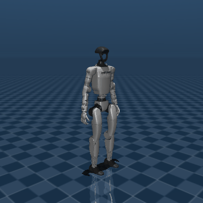

# Gymnastics Facility Robot

[日本語](README.ja.md) | [English](README.en.md) | **中文**

© 2026 MotionLink. All rights reserved.

<!-- Project badges: repository metrics update through Shields.io; technology labels describe this codebase. -->
[](https://github.com/Tsubasaas/Gymnastics-Facility-Robot_vf/commits/main/)
[](https://github.com/Tsubasaas/Gymnastics-Facility-Robot_vf/stargazers)
[](https://github.com/Tsubasaas/Gymnastics-Facility-Robot_vf/issues)
[](https://github.com/Tsubasaas/Gymnastics-Facility-Robot_vf/forks)

[](requirements-real.txt)
[](开始彩排.bat)
[](real_robot.py)
[](sim_viewer.py)

**让 Unitree G1 演示广播体操，并用日语语音和摄像头反馈带领参与者跟练。**

本项目将动作编排、MuJoCo 预览、Qwen 动作生成、语音合成、视觉反馈和 G1 上肢控制连接起来。首次使用不需要机器人：先在电脑上播放动作，确认效果后，再逐步接入摄像头和真机。

切换 README 语言只改变文档语言；当前演示的语音台词仍为日语。

## 1. 能达到什么效果？

| 功能 | 你会看到或听到什么 | 所需条件 |
| --- | --- | --- |
| 离线动作预览 | G1 模型播放预设动作，可暂停、回放、切换动作、调速 | 电脑、MuJoCo、G1 模型 |
| 广播体操演示 | 挥手与胸前礼开场，接伸展、摆臂、绕臂、扩胸、体侧屈五个环节 | `demo_viewer.py`；无需 API Key |
| 日语语音带练 | 开场问候、逐节动作提示、结束语；缺少语音配置时显示控制台字幕 | `demo_voice.py`；语音需要云端 API |
| 摄像头互动 | 按参与者胸前 A/B/C 字母或约定站位区分人员，针对动作给出简短日语反馈，并生成场次记录 | 摄像头、视觉模型 API、演出时钟 |
| 自然语言编排 | 输入“慢慢抬起右手，再放下”等文字，生成关节路点并预览或检查 | `ai_viewer.py` / `ai_robot.py`、动作生成 API |
| G1 真机带练 | 人工确认后执行上肢及经允许的腰部动作，可用 G1 扬声器播放语音 | 支持 SDK 的 G1 EDU、网络和现场联调 |

**当前演出是广播体操第一的五节改编，不是完整十三节的全身复刻。** 动作针对 G1 关节与速度限制做了调整；本项目不控制行走，也不实现腿部跟练。仓库另有基础动作及更长序列，不能与演出入口的预设编号混用。

MuJoCo 查看器采用直接设置关节角度的**运动学回放**，可以检查动作外观、节奏、关节限位和模型自碰撞，但不能证明真机平衡、负载或接触安全。视觉反馈是基于抽样图像和规则的定性提示，不是精确人体关节测量。

### 预览素材

以下是仓库中已有的基础动作预览，不代表当前五节演出的完整录屏：



更多动图见 [preview](preview/)，视频素材见 [group gymnastics.mp4](group%20gymnastics.mp4)。

## 2. 技术栈与工作流程

| 层次 | 当前实现 | 对应文件 |
| --- | --- | --- |
| 运行环境 | Python；操作示例面向 Windows PowerShell，真机环境使用 Python 3.10 | `requirements-real.txt` |
| 动作数据 | 关节角度路点、线性插值、按节拍编排、执行前限速 | `motions.py`、`demo_viewer.py`、`real_robot.py` |
| 三维预览 | MuJoCo + Google DeepMind MuJoCo Menagerie 的 Unitree G1 模型 | `sim_viewer.py`、`ai_viewer.py` |
| 动作生成 | OpenAI Python SDK 调用 DashScope 国际版兼容接口；默认 `qwen3-max` | `llm_motion.py` |
| 视觉反馈 | OpenCV / NumPy 采样；DashScope SDK；默认 `qwen3-vl-plus`，预览定位默认 `qwen3-vl-flash` | `vision_coach.py`、`vision_rules.py` |
| 语音 | 默认 `qwen3-tts-flash`、`Cherry` 音色、日语；异步队列和音频缓存 | `tts_qwen.py`、`demo_voice.py` |
| 真机通信 | Unitree SDK2 Python + CycloneDDS 0.10.2；读取 `rt/lowstate`，发送 `rt/arm_sdk` | `real_robot.py` |
| 摄像头链路 | 本机 OpenCV；或 Paramiko SSH 启动 PC2 采集端，再经 TCP 传送 JPEG；另有头部相机 DDS RPC 入口 | `robot_camera.py`、`brio_sender.py` |
| 机器人音频 | Unitree `AudioClient.PlayStream`，16 kHz / 16 bit / 单声道 PCM | `robot_speaker.py` |
| 进程协作 | JSON 文件传递播放时钟、观察结果及场次报告 | `vision_clock.json`、`observations.json`、`session_report.json` |

动作链路：**预设或文字指令 → 路点 → 关节与时间轴校验 → 仿真预览 / 真机限速 → 人工确认 → G1 执行。**

互动链路：**演出时钟 → 摄像头关键帧 → 视觉模型与反馈规则 → 观察结果 → 语音播报。** 当前规则包含绕臂、扩胸、体侧屈三节；以 `vision_rules.py` 的 `SECTIONS` 为准。

模型名称是代码默认值，实际可用性取决于你的 DashScope 国际版账号权限。使用云端功能会发送文字或摄像头采样图像，并可能产生 API 费用；现场拍摄前应取得参与者同意。

## 3. 第一次运行：先在电脑上看动作

### 3.1 获取项目和创建预览环境

准备 Git 和 Python 3.10。仓库为私有时，先使用有访问权限的 GitHub 账号完成 Git 身份认证。

以下命令均在 PowerShell 执行；后续所有脚本都从项目根目录启动。

```powershell
git clone https://github.com/Tsubasaas/Gymnastics-Facility-Robot_vf.git
cd Gymnastics-Facility-Robot_vf
py -3.10 -m venv .venv
.\.venv\Scripts\python.exe -m pip install --upgrade pip
.\.venv\Scripts\python.exe -m pip install mujoco "openai>=2.0,<3" "dashscope>=1.20,<2" opencv-python numpy paramiko
```

本指南将电脑预览环境 `.venv` 与真机环境 `.venv-real` 分开；两个环境目录均已加入 `.gitignore`，不上传到 Git。

### 3.2 下载 G1 模型

```powershell
git clone --depth 1 https://github.com/google-deepmind/mujoco_menagerie.git
Test-Path .\mujoco_menagerie\unitree_g1\scene.xml
```

最后一条应返回 `True`。代码默认读取此相对路径；若模型放在其他位置，修改 `sim_viewer.py` 中的 `MODEL_PATH`。下载 ZIP 时也要保留模型 XML 引用的网格等资源，不能只复制 `scene.xml`。

### 3.3 播放五节演出

```powershell
$env:PYTHONUTF8 = '1'
$env:DEMO_PAUSED = '1'
.\.venv\Scripts\python.exe demo_viewer.py
```

**成功标志：** 出现 G1 三维窗口；点一下窗口，按空格开始播放。默认完整序列包含开场和五节动作。

| 按键 | 演出查看器中的作用 |
| --- | --- |
| `1` | 完整演出 |
| `2`～`6` | 五个单节 |
| `7` | 开场问候动作 |
| 空格 | 暂停 / 继续 |
| `R` / `L` | 从头播放 / 切换循环 |
| `←` / `→` | 后退 / 前进 5 秒 |
| `-` / `=` | 降低 / 提高播放速度 |
| `Esc` | 退出查看器 |

想看基础动作集，运行 `.\.venv\Scripts\python.exe sim_viewer.py`。它的数字编号与演出查看器不同，以终端输出为准。安装和模型下载完成后，这两种预览都不需要联网或 API Key。

## 4. 加入日语语音、AI 和视觉互动

### 4.1 配置 API Key

本项目使用 DashScope **国际版**端点。在运行程序的 PowerShell 窗口中设置环境变量，不要把密钥写入源码：

```powershell
$apiCredential = Get-Credential -UserName 'DashScope' -Message '在密码栏输入 DashScope 国际版 API Key'
$env:DASHSCOPE_API_KEY = $apiCredential.GetNetworkCredential().Password
```

环境变量会传给从该窗口启动的子进程；新开的独立终端需要重新设置。程序不会自动读取 `.env` 文件。

### 4.2 运行语音演出或自然语言预览

```powershell
# 五节演出 + 日语语音；未配置语音时仍可用字幕彩排
.\.venv\Scripts\python.exe demo_voice.py

# 自然语言动作预览（关闭前一个程序后运行）
.\.venv\Scripts\python.exe ai_viewer.py
```

`ai_viewer.py` 的自然语言指令在终端中输入。先尝试单臂、小幅、慢速动作；查看生成结果后再考虑真机使用。

### 4.3 接入笔记本摄像头

打开两个 PowerShell 窗口，均进入同一个项目根目录并配置 API Key。

窗口 A：

```powershell
$env:VISION_NAMES = 'AB'
.\.venv\Scripts\python.exe vision_coach.py --cam 0 --show
```

窗口 B：

```powershell
$env:VISION_NAMES = 'AB'
$env:DEMO_PAUSED = '1'
.\.venv\Scripts\python.exe demo_voice.py
```

参与者佩戴醒目的 A/B 字母标识，按约定站位入镜。窗口 A 初始显示“等待时钟”是正常的；在仿真窗口按空格播放完整演出后，视觉进程才会随动作采样和评判。反馈通过 `observations.json` 交给语音进程，场次输出见 `session_report.json` 与 `records/`。

没有识别到人、结果迟到或语音通道忙时，不保证每节都播报反馈。摄像头编号不正确时，将 `--cam 0` 改为实际编号。

### 4.4 接入 G1 上的外接 Brio 摄像头

完成下文真机环境和网络配置后，在启动摄像头的同一个窗口设置设备密码：

```powershell
$deviceCredential = Get-Credential -UserName 'unitree' -Message '输入 PC2 设备 SSH 密码'
$env:PC2_PASS = $deviceCredential.GetNetworkCredential().Password
.\.venv-real\Scripts\python.exe robot_camera.py --probe
```

代码默认 PC2 地址为 `192.168.123.164`、用户为 `unitree`。实际配置不同，需修改 `robot_camera.py` 的 `PC2_HOST` / `PC2_USER`。PC2 需要可用的 Python 3、OpenCV、SSH 服务和摄像头访问权限；采集脚本见 `brio_sender.py`。该入口会上传并启动采集脚本，并重启同名采集进程。

抓帧成功后，使用 `.\.venv-real\Scripts\python.exe vision_coach.py --show` 接入机器人外接摄像头。未设置 `PC2_PASS` 会在 SSH 登录前报错。头部内置相机可用 `robot_camera.py --source head --probe` 单独验证，但视觉教练默认入口仍为外接 Brio。

## 5. 如何开启 G1 真机运行

### 5.1 硬件上电与现场准备

本项目面向**支持 SDK 的 G1 EDU**，必须按实机确认 23 / 29 DOF 和腰部硬件配置。完整五节演出使用腰部俯仰与侧倾，不能仅凭“29 DOF”就假定当前硬件与控制模式可用。

1. 由熟悉该台设备的操作者安装防倒保护，确认电池、线缆、活动空间及急停条件；一人全程持有实体急停或遥控器。
2. 按该台 G1 对应的官方手册完成电池上电、启动自检和所需姿态准备。电源按键、遥控器组合键及控制模式取决于硬件与固件，本仓库没有自动完成这些操作的脚本。
3. 确认当前控制模式支持本项目的 `arm_sdk` 上肢接口，并停止冲突的上肢控制程序。不要将全身低层控制示例的启动流程直接套用于本项目，也不要随意关闭维持站立所需的控制服务。
4. 先完成下列只读检查，再执行小幅探针；通过后才进入单节和完整演出。

硬件操作请查阅 [Unitree G1 官方开发文档](https://support.unitree.com/home/zh/G1_developer)，SDK 配置见 [Unitree SDK2 Python 官方仓库](https://github.com/unitreerobotics/unitree_sdk2_python)。本文提供的是本项目软件启动流程，不能替代对应实机的上电与模式操作手册。

### 5.2 建立独立真机环境

```powershell
py -3.10 -m venv .venv-real
.\.venv-real\Scripts\python.exe -m pip install --upgrade pip
.\.venv-real\Scripts\python.exe -m pip install -r requirements-real.txt
.\.venv-real\Scripts\python.exe -m pip install opencv-python numpy paramiko
```

`requirements-real.txt` 固定 CycloneDDS 版本和 Unitree SDK 提交，另外列出 OpenAI / DashScope SDK。摄像头依赖通过最后一条补充。真机执行本身不需要下载 MuJoCo 模型；电脑彩排仍使用 `.venv`。

若提示找不到 CycloneDDS，先按 [官方 SDK 安装说明](https://github.com/unitreerobotics/unitree_sdk2_python#installation)配置本机原生 CycloneDDS 及 `CYCLONEDDS_HOME`。不要因为安装失败就随意更换已固定的版本；Windows 原生依赖可能需要额外配置。

### 5.3 配置有线网络

本项目现有现场地址如下，使用前请确认是否与你的设备一致：

| 设备 | 示例配置 |
| --- | --- |
| G1 PC2 | `192.168.123.164` |
| 电脑连接机器人的有线网卡 | `192.168.123.222`，掩码 `255.255.255.0` |

将电脑对应网卡配置到同一网段，避免地址冲突。命令中的 `--interface` 是**电脑网卡的 IP 地址**，不是机器人地址。

```powershell
ping 192.168.123.164
```

Ping 仅检查 IP 连通性；DDS 是否可用以下一步收到 `lowstate` 为准。若超时，检查网卡选择、防火墙规则及 DDS 网络配置。

### 5.4 第一次连接：只读取状态

以下以已确认的 29 DOF 设备为例；23 DOF 设备须相应替换参数。

```powershell
.\.venv-real\Scripts\python.exe ai_robot.py `
  --robot-dof 29 --interface 192.168.123.222 --read-only
```

**成功标志：** 显示已收到新鲜的 G1 `lowstate`，输出关节角度、模式和温度，最后提示没有创建 `rt/arm_sdk` publisher。此步骤无需 API Key，不发送动作命令。

### 5.5 第一次动作：右肘 5° 探针

先在当前终端按 4.1 节设置 `DASHSCOPE_API_KEY`。**当前代码在进入交互循环时就初始化 AI 客户端，因此即使只输入 `probe` 或预设编号，也要求配置 Key 和 OpenAI SDK。** 预设和探针本身不请求动作生成模型；只读模式不受此限制。

```powershell
.\.venv-real\Scripts\python.exe ai_robot.py `
  --robot-dof 29 --interface 192.168.123.222 `
  --max-speed-deg 10 --execute
```

按终端提示依次操作：

1. 核对现场条件后输入 `ENABLE REAL ROBOT`。
2. 收到状态并出现 `AI-G1 >` 后，输入 `probe`。
3. 查看动作计划，确认是右肘相对当前角度移动 5° 后返回。
4. 输入程序当次显示的完整 `RUN XXXX` 确认码；其他输入会取消动作。
5. 确认运动方向、回位和控制权重释放正常；随后输入 `q` 退出。

动作执行中，`Ctrl+C` 会触发软件中断与权重释放流程，**不是实体急停的替代品**。发生危险时由现场操作者使用已确认的硬件急停流程。

### 5.6 从单节过渡到完整演出

先以低速运行演出入口：

```powershell
.\.venv-real\Scripts\python.exe demo_robot.py `
  --robot-dof 29 --interface 192.168.123.222 `
  --max-speed-deg 10 --execute
```

完成启动确认后，先测试 `p1`，再逐节检查；每个动作都需要独立的 `RUN XXXX` 确认。

| `demo_robot.py` 输入 | 动作 |
| --- | --- |
| `p1` | 伸展 |
| `p2` | 摆臂 |
| `p3` | 绕臂 |
| `p4` | 扩胸，包含腰部俯仰 |
| `p5` | 体侧屈，包含腰部侧倾 |
| `p6` | 挥手与胸前礼，包含腰部动作 |
| `p7` | 开场 + 五节完整演出 |

未启用腰部时，包含相关关节的动作会被拒绝，这是预期行为。只有已确认腰部硬件、控制模式且逐节测试通过，才添加 `--allow-waist-roll-pitch`。正式演出可在现场确认速度合适后使用：

```powershell
.\.venv-real\Scripts\python.exe demo_robot.py `
  --robot-dof 29 --interface 192.168.123.222 `
  --max-speed-deg 45 --allow-waist-roll-pitch --robot-speaker --execute
```

输入 `p7` 并确认当次随机码后开始完整演出。`45°/s` 是演出入口默认值及当前代码允许的最高设定，不是首次测试建议值；低速时程序会延长动作时间，语音与视觉时序仍需在现场复核。G1 音频服务不可用时会尝试回退电脑播放。

需要视觉互动时，提前启动 4.3 或 4.4 节的视觉进程，真机演出会写入同一套时钟文件。结束后等待权重释放，输入 `q`，关闭视觉进程，再由操作者按对应实机手册完成姿态恢复和断电。

### 5.7 现有批处理启动器的使用前提

- `开始彩排.bat`：视觉进程固定使用 `.venv-real`，语音预览使用当前 `python`。先准备两个环境，并在当前终端运行 `.\.venv\Scripts\Activate.ps1`，再启动批处理；从设置过环境变量的窗口运行，子进程才能继承 Key / 密码。
- `真机演出.bat`：当前写死 29 DOF、`192.168.123.222`，已启用腰部与机器人扬声器，并采用演出入口的默认 `45°/s`。**首次联调使用上面的分步命令，不直接启动此批处理。**

## 6. 常用配置与文件导航

### 控制台、真实报告与四人示例

运行 `python vision_coach.py --web --cam 0` 可使用本机摄像头打开控制台；
使用机器人外接摄像头时省略 `--cam 0`。同时重启演出/语音进程，以使用相同的场次 ID 协议。
网页 `/report` 默认读取最近更新的真实记录；`/report?mode=sample` 保留四人示例。
也可用 `/report?id=taiso_<场次ID>.json` 查看指定场次。没有真实记录时不会自动显示示例。

新版记录为每次评判保存场次 ID、识别编号、原始模型条目、采样时间、人物框和运动分数。
报告下方可展开对应采样图片。记录和图片保存在本机 `records/`，该目录不提交到 Git。
人物只按清晰胸前字母识别，不再按站位猜测；重复字母和不确定结果不会自动认定达标。
当前实际评判仍只有③绕臂、④扩胸；不足三张有效关键帧时记录为采样不足。

演出中的表情抽样会按拍摄时的场次、节次、人物、时间和图片存档；空闲预览不计入场次统计。
不确定表情单独计数，不纳入积极率分母。动作评判优先，表情采样通常间隔四秒，
未启用网页或调试窗口时也会采样；新增表情调用会产生相应 API 请求。

每条语音有独立编号，反馈还关联原识别编号和反馈编号。回执记录排队、合成、播放处理、
失败、回退、静音跳过、旧场次取消和仅字幕等状态；相同文本重复播放仍是不同语音条目。
本机 `completed` 表示阻塞播放器正常返回；G1 的 `robot_sent` 只表示 PlayStream 接收成功并已等待预计时长，
**不代表硬件报告播放完成，更不证明现场听到了声音**。G1 真正的播放完成确认仍需硬件接口支持。
活动完成参与情况也不推断。旧版记录缺失的字段不补造数据。
表情与音频分别写入 `records/events/<场次ID>/` 的原子事件文件，避免多进程互相覆盖。
真实报告合并这些事件，提供逐条表情明细和语音状态时间线，CSV/JSON 导出包含关联编号。
标注画面使用识别时的同一张快照并显示时间；演出中显示未叠加旧人物框的实时画面。

只精修界面、不使用摄像头和机器人时可运行 `python preview_console.py`，访问
`http://[::1]:8081/`。此入口也能读取本地真实记录及四人示例，但不会启动真机。
离线对应关系测试：`python -m unittest -v test_observation_records test_session_events`（相机、模型和播放器使用模拟）。

| 环境变量 | 用途 / 默认值 |
| --- | --- |
| `DASHSCOPE_API_KEY` | 云端动作、视觉及语音服务 Key |
| `PC2_PASS` | 外接机器人摄像头 SSH 密码，无默认密码 |
| `QWEN_MODEL` | 动作生成模型：`qwen3-max` |
| `VISION_MODEL` / `VISION_PREVIEW_MODEL` | 动作评判 / 预览定位模型 |
| `QWEN_TTS_MODEL` / `QWEN_TTS_VOICE` / `QWEN_TTS_LANGUAGE` | 语音模型 / 音色 / 语言 |
| `VISION_NAMES` | 参与者字母，默认 `ABC`；两人可设 `AB` |
| `DEMO_PAUSED` | 设为 `1` 后仿真启动即暂停 |
| `DEMO_BPM` / `DEMO_GAP` | 编排节拍 / 节间间隔，默认 `77` / `1.0` 秒 |
| `DEMO_COUNT` | 设为 `1` 启用可选节拍报数 |
| `G1_SPEAKER_VOLUME` / `G1_SPEAKER_GAIN` | G1 播放音量 / 软件增益 |

不要为了消除限速提示直接提高节拍或放大动作；调整后需重新检查动作和真机时序。

| 想修改或查看什么 | 文件 |
| --- | --- |
| 五节动作、节拍、开场 | [demo_viewer.py](demo_viewer.py) |
| 基础动作与导出路点 | [motions.py](motions.py)、[export_waypoints.py](export_waypoints.py) |
| 日语台词和播报时机 | [demo_voice.py](demo_voice.py) |
| 视觉判断标准和反馈句 | [vision_rules.py](vision_rules.py) |
| 真机限速、状态监测与权重释放 | [real_robot.py](real_robot.py) |
| 真机补充说明 | [REAL_ROBOT.md](REAL_ROBOT.md) |
| 基础动作检查 / 演出动作检查 | [validate.py](validate.py)、[_check_demo.py](_check_demo.py) |

```powershell
# 在已安装 MuJoCo 并下载模型的预览环境运行
.\.venv\Scripts\python.exe validate.py
.\.venv\Scripts\python.exe _check_demo.py
```

这些检查不驱动真机，不能替代现场测试。

## 7. 常见问题

| 问题 | 排查方式 |
| --- | --- |
| 找不到 `scene.xml` | 从项目根目录启动；核对模型目录层级及 `MODEL_PATH` |
| `py -3.10` 不可用 | 安装 Python 3.10，或使用该版本 `python.exe` 的完整路径创建环境 |
| 语音只有字幕 | 检查当前进程的 Key、DashScope 依赖、国际版端点及模型权限；本机音频实现面向 Windows |
| 预设动作也提示缺 API Key | 当前真机交互入口会初始化 `MotionAgent`；按 4.1 配置，或先使用无需 Key 的离线查看器 |
| 视觉一直等待时钟 | 确认同目录运行 `demo_voice.py` 或 `demo_robot.py`，并开始完整演出 |
| 外接摄像头登录失败 | 确认 `PC2_PASS`、地址、用户、SSH 权限和 PC2 的 OpenCV / 设备权限 |
| 收不到 `lowstate` | 核对电脑网卡 IP、DDS 配置、防火墙和机器人当前服务；不要跳过只读检查 |
| 腰部动作被拒绝 | 核对硬件与现场授权后再使用腰部参数；不要删除校验 |
| 演出比预览慢或报幕不齐 | 限速会拉长时间轴；核对速度、节拍、API 延迟和实际执行状态 |
| 扬声器无声 | 核对 G1 音频服务与音量；观察终端是否提示回退到电脑 |

本文按仓库当前代码整理。环境安装、云端权限和真机固件会影响运行结果；首次部署应逐项验证各阶段的成功标志。
